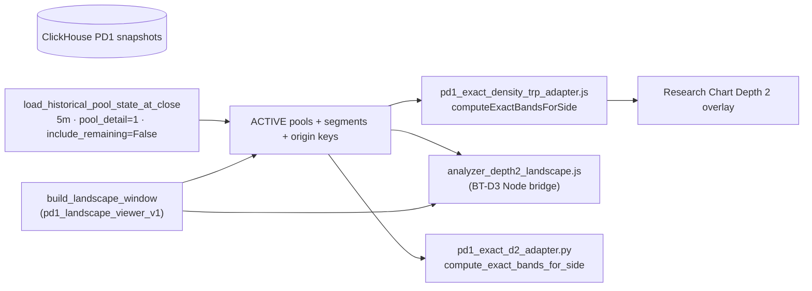

# L1 V3AG — Bestehende Pool-Density- und Konzentrationslogik (READ-ONLY)

**Datum:** 2026-11-09  
**Scope:** Gesamtes Forschungsprojekt (spread dashboard + `pools+ob+delta_bot` Phase G/BT-D/P17/6XT), nicht nur V3W/L1.  
**Keine Implementierung, keine Backtests, keine Strategieänderung.**

**Referenztrade (Forensik wie V3AB–V3AF):** DOGEUSDT 5m · Entry `2026-08-26 20:30 UTC` @ `0.08491` · Snapshot SHA256 `b0718d82a94e8ad12d27d570c0cd7ce97cf8088a2db21c4c92830cd80fc600cb`

---

## Executive summary

| Frage | Kurzantwort |
|--------|-------------|
| **A — Kanonische PD1-D2-Density** | Research Chart: `pd1_exact_density_trp_adapter.js` → `computeExactBandsForSide`. Server/BT-D3: `get_density_bands` + Node `analyzer_depth2_landscape.js` über `build_landscape_window`. L1-Parität: `pd1_exact_d2_adapter.py` (explizit JS-parity). |
| **B — Starke zusammenhängende Konzentrationen** | **Ja, teilweise:** D2-Merge + Filter/Score in V3W (`merge_qualified_zones`, `resolve_tp2`/`tp3`, `resolve_multi`). **Nein** als freigegebene Dominanz-Klassifikation: keine produktive „relevant vs irrelevant“-Funktion mit ∫Density-Ranking; V3AF-Merkmale nur im Audit-Skript/JSON dokumentiert, nicht als Library. |
| Mikro vs D2 | `pool_landscape.py` und `dynamic_big_picture_v1.substantial_cluster` arbeiten auf **Micro-Overlap**, nicht auf kanonischer D2-SSOT. |
| Referenzzone 0.08929–0.089624 | Von **D2-Merge erkannt** (Zone #6 @ Entry); **stärker** als 0.08536/0.08604 nach V3AF-Metriken; **TP2** wählt sie nicht (aufsteigende Erstwahl); **TP3** wählt ferne Cluster; **Produktion** `pick_tp` → max D2 (0.09496-Nähe). |

---

## 1. A — Kanonische Exact Unique-Origin D2 Density (SSOT → Chart)

### Datenpfad (End-to-End)

| Stufe | Pfad | Funktion | Vertrag |
|--------|------|----------|---------|
| SSOT | `spread_recovery_hedge_short_dev/dashboard/research_charts/historical_pool_state_v1.py` | `load_historical_pool_state_at_close` | Phase-F-Identität 5m PD1; kausal `include_remaining=False` |
| Fenster | `dashboard/.../pd1_landscape_viewer_v1/historical_window_v1.py` | `build_landscape_window` | Liefert `pools[]` mit `origin`, `segments`, Bounds |
| **Chart (normativ)** | `dashboard/static/js/research/pd1_exact_density_trp_adapter.js` | `computeExactBandsForSide` (Z.40–73) | 5m-Slot, ACTIVE@t, origin-dedupe, Preis-Sweep → depth |
| Research-Module | `dashboard/static/js/research/pd1_exact_origin_density_research_v1.js` | Renderer + min-depth/min-origins UI | Nutzt Adapter; Tests: `test_pd1_density_research_live_integration_v1.py` |
| **BT-D3 Provider** | `pools+ob+delta_bot/tools/phase_bt_d3_canonical_depth2_provider_v1/density_provider_v1.py` | `get_density_bands` | Contract `density_contract_v1.json`: `exact_unique_origin`, 5m, PD1, `min_unique_origins≥2` |
| Node-Pfad | `.../node_bridge_v1.py` → `analyzer_depth2_landscape.js` | Chart-equivalent density | G1/G1B: Parität mit Cache via `bands_for_parity` / `compare_band_sets` |
| **L1 Python-Parität** | `manual_channel_pool_long_v1/pd1_exact_d2_adapter.py` | `compute_exact_bands_for_side`, `upper_d2_bands_at_close` | `D2_COMPUTE_VERSION = computeExactBandsForSide-parity-v1` |
| L1 Gate/TP Rohliste | `manual_channel_pool_long_v1/pool_d2_metrics.py` | `qualify_upper_d2_bands`, `analyze_d2_landscape` | depth≥2, dist≥`MIN_POOL_DIST_PCT` (0,5 %) |

**L1 Pilot-Ladepfad:** `run_l1_pilot.py` lädt SSOT wie Chart-Forensik (`load_historical_pool_state_at_close`, `timeframe=5m`, `pool_detail=1`).

**Dokumentierte Abweichung (historisch):** `l1_v3a_d2_source_audit.md` — vor D2-Adapter nutzte L1 Micro-`lower_bound`-Listen; **jetzt** paritätspfad über `pd1_exact_d2_adapter` in V3AB/V3W/V3Y.

---

## 2. B — Bewertung von Poolkonzentrationen (≠ reine D2-Filterung)

### Inventar relevanter Implementierungen

| Datei | Funktion/Klasse | Zweck | Eingabe | Merkmale | Verwendet von |
|--------|-----------------|-------|---------|----------|----------------|
| `tp_research_v3w/zone_features.py` | `merge_qualified_zones`, `enrich_zone_origins`, `zone_score` | D2-Segmente → zusammenhängende Zonen (gap 0,15 %); Origins per Span | qualifizierte D2-Einzelbänder + SSOT members | `width_pct`, `max_depth`, `unique_origins`, `band_count` | V3W `tp_targets`, V3AE, V3AF-Audit |
| `tp_research_v3w/tp_targets.py` | `resolve_tp2`, `resolve_tp3`, `resolve_multi` | **Statische TP-Auswahl** @ Entry | pending row + D2 qualified | TP2: erste Zone mit Min width/depth/origins; TP3: max `zone_score`; M3: zwei „substantial“ Zonen | V3W Backtests, V3AE |
| `pool_landscape.py` | `analyze_upper_landscape` | Entry-Gate „substantial vs thin“ | **Micro** members | merged zones, `substantial_zones`, nearest dist, gaps | L1 Variante `B+POOL` (nicht V3AB-TP) |
| `config.py` (L1) | Schwellen | provisional Entry-Landschaft | — | `MIN_BANDS_PER_SUBSTANTIAL_ZONE=3`, `MAX_DISTANCE_TO_FIRST_SUBSTANTIAL=2.2%`, … | `pool_landscape` |
| `pool_d2_metrics.py` | `analyze_d2_landscape`, `apply_d2_gate_to_pending` | D2-Gate + Metriken | members @ decision_close | nearest D2 dist/depth; **kein** Zonen-Merge | V3Y/V3AB/V3W context |
| `run_l1_pilot.py` | `pick_tp` | Produktionsregel LONG-Pilot | qualified D2 dicts | **max(lower_bound)** oder Kanal-Nähe | V3AB Baseline |
| `run_l1_v3d_d2_landscape_analysis.py` | `merge_adjacent_bands`, `substantial_distances` | Diagnose-Skript Kanal×D2 | D2Band-Liste | gap-merge, erste N Distanzen | Forschungsberichte V3D |
| `dynamic_liquidity_landscape_v1.py` | `analyze_side`, `merge_interval_clusters` | Micro-Pool-Overlap-Cluster | Micro rows + Preis | `max_overlap_depth`, `pool_count`, gaps | Big Picture, Phase 6XT |
| `dynamic_big_picture_v1.py` | `substantial_cluster`, `target_regions_from_landscape` | Rollen: nearest / nearest_substantial / densest | `analyze_side` output | width, pool_count, overlap depth | Phase G Design Feature A; Forschungs-Tracker |
| `upper_pool_gap_tp_v1.py` (long_v3 / P17) | `merge_atomic_uppers_into_regions`, TP-Helper | Regionen aus **vorgefertigten** D2-Atomics (`unique_origin_count`) | density snapshot `upper_bands` | region span, distinct origins | P17 AU/AV LONG-Forschung (anderes Datenformat als L1 members) |
| `phase6xt_pd1_strength_density_v1.py` | Stärke-Farb-Diagnostik | Visual **strength** vs D2-Analyse | SSOT + `analyze_side` | strength buckets | READ-ONLY Overnight-Import |
| `phase_bt_d3_.../density_provider_v1.py` | `get_density_bands` | Kanonische Bänder für Backtester | ISO close | upper/lower band list | BT-D7 landscape, G1, D8 cache |
| `dominant_upper_pool_v3af/` (Artefakte) | *kein persistentes `.py` im Repo* | Dominanz-Audit | V3W merge + manuelle ∫Density | Rankings CSV/JSON | V3AF nur Bericht |

### Metadaten pro Implementierung

| Komponente | Ausführbar | Tests | Kausal | Exakt D2-SSOT | Strategie vs Diagnose | Status |
|------------|------------|-------|--------|---------------|----------------------|--------|
| `computeExactBandsForSide` (JS) | Chart | viele `test_pd1_*` | ja @ decision close | **SSOT** | Diagnose/Render | **ACTIVE** |
| `pd1_exact_d2_adapter.py` | ja | `test_l1_v3e_d2_filters.py` | ja | **Parität SSOT** | L1 Forschung/Gate | **ACTIVE** |
| `get_density_bands` | ja | G1/G1B, BT-D91/92 | ja | **Contract SSOT** | Backtester/G-Panel | **ACTIVE** |
| `merge_qualified_zones` + TP2/3 | ja | `test_v3w_smoke.py` | statisch @ entry | ja (auf qualified D2) | **RESEARCH_ONLY** | **ACTIVE** |
| `pool_landscape` | ja | indirekt Pilot | ja | **nein (Micro)** | Entry-Filter deprecated path | **PROVISIONAL** |
| `substantial_cluster` (big picture) | ja | in module `main` | ja | **nein (Micro overlap)** | Feature-G / Tracker | **RESEARCH** |
| `pick_tp` max D2 | ja | `test_l1_v3l_independent_support.py` | ja | nutzt qualified D2 | **V3AB Produktion** | **ACTIVE** |
| Phase G Features A–H | Design | G1 causality | ja | D2 via provider | **kein Scoring** | **APPROVED design, G2 defers impl.** |
| ∫Density-Ranking (V3AF) | nur Audit-JSON | — | ja | ja | rein diagnostisch | **RESEARCH_ONLY, nicht library** |

**Abgrenzung:** `qualify_upper_d2_bands` + `pick_tp(max)` sind **Filter + Fernziel**, keine Dominanzbewertung. `resolve_tp2` ist **Ersttreffer** nach Schwellen, keine globale ∫Density/Rangwahl.

---

## 3. Frühere Forschungsergebnisse (Beschlüsse vs Experiment)

| Quelle | Inhalt | Status |
|--------|--------|--------|
| `l1_v3_pool_landscape.md` | Entry „substantial“: ≥3 Bänder/ZONE oder width; erste Zone ≤2,2 %; ≥3 substantial zones | **PROVISIONAL** (explizit vorläufig) |
| `PHASE_G_DYNAMIC_POOL_LANDSCAPE_RESEARCH_DESIGN_V1.md` | Features A–H: deskriptive Δ-Metriken (Cluster, Gaps, D2 spans); **explizit keine abgeleiteten Scores** | **APPROVED design**; Panel-Implementierung G2+ offen |
| `PHASE_G1_DATA_PARITY_AND_FEATURE_VALIDATION_V1.md` | D2 cold vs cache **PASS**; `exact_unique_origin` 5m PD1 verbindlich | **APPROVED** |
| `L1_V3AD_EXISTING_POOL_TP_LOGIC_AUDIT.md` | Violett als Merge-Zone erkannt; kein freigegebener Resolver wählt sie @ Entry | **Bericht** |
| `V3W_TP_RESEARCH_REPORT.md` | TP2 @ Aug-26 → 0.08604; substantial ≠ chart-dominant violet | **RESEARCH empirisch** |
| `L1_V3AF_DOMINANT_UPPER_POOL_AUDIT.md` | ∫Density-Rang, Origins, Breite — **kein neuer Produktions-Score** | **RESEARCH audit** |
| BT-D7 `density_contract` in manifests | `min_unique_origins≥2`, landscape SHORT research | **RESEARCH** (anderes Setup) |
| Phase 6XT strength density | Farbskala auf `strength` Feld | **Diagnostik**, nicht D2 depth |

**Kein dokumentierter APPROVED-Beschluss** für: Mindest-∫Density, globaler Dominanz-Rang als TP, oder verbindliche Unterscheidung „isolierter Streifen vs Konzentration“ auf D2-Ebene — nur **experimentelle** V3W-Grids und V3AF-Rankings.

---

## 4. Referenzzone — bestehende Funktionen (ohne neue Parameter)

**Ziel:** `0.08929–0.089624` (V3AF-Merge). Vergleich: `0.08536–0.08546`, `0.08604–0.08628`.

Metriken @ Entry (aus `dominant_upper_pool_v3af/l1_v3af_target_zone_details.json`):

| Zone | dist % | max depth | origins | ∫Density | ∫Density-Rang (1–15) |
|------|--------|-----------|---------|----------|----------------------|
| 0.08536–0.08546 | 0.53 | 4 | 4 | 0.00034 | 9 |
| 0.08604–0.08628 | 1.33 | 5 | 5 | 0.00070 | 5 |
| **TARGET** | **5.16** | **5** | **6** | **0.00100** | **3** |

### Was würde **vorhandener Code** tun?

| Funktion | TARGET | Nahe Zonen | Anmerkung |
|----------|--------|------------|-----------|
| `merge_qualified_zones` | Eine zusammenhängende Zone (#6 nach Dist) | eigene Merge-Zonen (#1, #2) | **Erkennt Konzentration** |
| `resolve_tp2` (TP2a/b/c) | **Nicht gewählt** | TP **0.08536** / **0.08604** | Aufsteigend erste Zone mit width/depth/origins — @ Referenztrade verifiziert |
| `resolve_tp3` (alle Varianten) | **Nicht gewählt** | TP **0.09342–0.09436** | Max score über alle Zonen mit dist≥0,5 % |
| `pick_tp` (V3AB) | ignoriert Merge | — | **0.09496**-Band (max lower_bound) |
| `analyze_upper_landscape` (Micro) | nicht „nearest substantial“ | nearest **0.53 %** | Entry-Gate **PASS** (14 substantial zones); Klassifikation Micro ≠ D2 |
| V3AF ∫Density-Ranking | **„stark“, Rang 3** | schwächer (Rang 9 / 5) | **Diagnostik**, keine Callable-Klasse |

**Einzel-Substantialitäts-Check (nur Leselogik TP2-Schwellen auf TARGET):** width 0,37 % ≥ TP2a 0,08 %; depth 5 ≥ 3; origins 6 ≥ 3 → Zone **erfüllt** TP2-Kriterien **isoliert**, scheitert aber an **Sortierung (nearest first)**.

---

## 5. Pflichtfragen (1–7)

1. **Verbindliche PD1-D2-Density?**  
   **Chart:** `pd1_exact_density_trp_adapter.js` → `computeExactBandsForSide`.  
   **Batch:** `tools/phase_bt_d3_canonical_depth2_provider_v1/density_provider_v1.get_density_bands`.  
   **L1:** `pd1_exact_d2_adapter.compute_exact_bands_for_side` (Parität).

2. **Ältere Funktion für zusammenhängende starke Konzentrationen?**  
   **Ja:** `merge_qualified_zones` (V3W, seit V3W-Forschung).  
   **Micro-Pfad:** `dynamic_liquidity_landscape_v1.merge_interval_clusters` + `substantial_cluster` (Phase G / Big Picture) — **nicht** D2-SSOT.  
   **P17:** `upper_pool_gap_tp_v1` Region-Merge auf D2-Atomic-Snapshots — verwandt, anderes API.

3. **Klassifikation relevant vs irrelevant?**  
   **Teilweise:** TP2-Grid = binäre „substantial zone“ pro Parameter-Set; `pool_landscape` = thin vs substantial (Micro). **Keine** freigegebene globale Relevanzliste für Upper-Pools.

4. **Vollständige Dominanzbewertung?**  
   **Nein** als Produktionsmodul. Nächste Annäherung: V3AF **deskriptive** Multi-Rank (∫Density, Origins, depth) + V3W `resolve_tp3` / `resolve_multi` — alles **RESEARCH_ONLY**.

5. **Wiederverwendung für L1 Pool-TP?**  
   **Ja (Kern):** `pool_d2_metrics` → `merge_qualified_zones` → erweiterte Selektion (z. B. V3AE `resolve_tp2`+Fallback, oder TP3/M3). **Nein** für `pick_tp`/`pool_landscape` allein.

6. **Was fehlt?**  
   - Callable **Dominanz-/Relevanz-API** (z. B. ∫Density, Distanz-Penalty, Kanal-Cap) mit freigegebenen Schwellen.  
   - Einheitliche Nutzung **nur** D2-SSOT (Micro-Landschaft aus Produktions-TP ausschließen).  
   - Persistente Implementierung von V3AF-Metriken (derzeit nur Audit-Artefakte).  
   - Freigabe welches `model_id` (TP2 vs TP3 vs Multi vs neues „first strong in channel“).

7. **Minimale Integration (falls reuse):**  
   1. Bereits vorhanden in V3AB context: `apply_d2_gate_to_pending` + `_pool_members`.  
   2. Import `tp_research_v3w.zone_features` + gewählter `resolve_*` aus `tp_targets` **oder** neuer dünner Wrapper, der **nur** bestehende Funktionen verdrahtet (wie V3AE).  
   3. **Kein** neuer Density-Sweep; SSOT bleibt `pd1_exact_d2_adapter`.  
   4. Optional: ∫Density-Zeile aus V3AF-Formel als **ein** Helper in `zone_features` (wäre *neu* — nicht Teil dieses Audits).

---

## 6. Empfehlung (nur Recherche)

Für „starke zusammenhängende Upper-Konzentration vs dünne Streifen“ ist der **reife, D2-kausale** Baustein `merge_qualified_zones` + origin enrichment; die **Lücke** ist **Auswahlregel** (TP2 first-match vs TP3 global vs ∫Density-Rang), nicht Density-Berechnung. Produktion und V3AB nutzen davon nur das **schwächste** Glied (`max` lower_bound).

---

## 7. Artefakte

| Pfad | Inhalt |
|------|--------|
| Dieser Bericht | `manual_channel_pool_long_v1/L1_V3AG_EXISTING_POOL_DENSITY_RESEARCH_AUDIT.md` |
| V3AF Zahlen Referenztrade | `dominant_upper_pool_v3af/l1_v3af_target_zone_details.json`, `l1_v3af_upper_zones.csv` |
| D2-Paritätsaudit | `l1_v3a_d2_source_audit.md` |
| Phase G SSOT | `pools+ob+delta_bot/reports/PHASE_G_DYNAMIC_POOL_LANDSCAPE_RESEARCH_DESIGN_V1.md` |

**STOP** — Audit abgeschlossen. Keine Codeänderungen.
