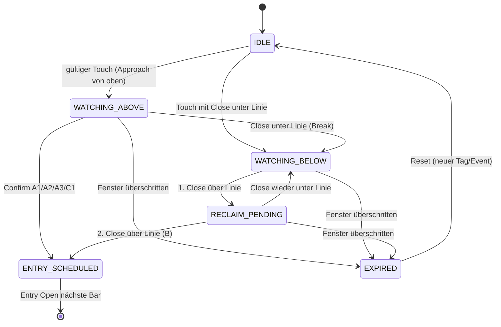

# L1 V3AN — Touch-Watcher & Reclaim: Analyse und Implementierungsplan

**Scope:** L1 Manual-Channel-Forschung (nicht P17). **V3AK unverändert.** Neues Modul: `touch_watcher_research_v3an/`.

## Zustandsdiagramm (Vorschlag)

**Deterministik:** Zustandswechsel nur auf **abgeschlossenen** 5m-Kerzen (Open-Zeit = Candle-ID). 
Linie `line.price_at(candle.time)` wie `run_l1_pilot` / `classify_candle_interval`. 
Während Watcher **kein** zweiter Parallel-Watcher (weitere Touches → ignoriert bis EXPIRED/Entry).

## Replay 30.08.2026 · 09:15–12:00 · `d-ea081434c5d3`

### Legacy-Referenz (unverändert `build_touch_events` + C1)

- `te-d-ea081434c5d3-0001` touch **2026-08-30 09:20:00 UTC** → entry **—** @ **—** `NO_C1`
- `te-d-ea081434c5d3-0002` touch **2026-08-30 10:20:00 UTC** → entry **—** @ **—** `NO_C1`
- `te-d-ea081434c5d3-0003` touch **2026-08-30 11:35:00 UTC** → entry **2026-08-30 11:45:00 UTC** @ **0.08491** ``
- `te-d-ea081434c5d3-0004` touch **2026-08-30 11:50:00 UTC** → entry **2026-08-30 12:00:00 UTC** @ **0.08492** ``

**Prod-Entry:** `te-d-ea081434c5d3-0003` touch **11:35** → confirm **11:40** → entry **11:45 @ 0.08491**.

### Varianten-Tabelle (Watcher-Replay, Fenster 12 Bars)

| Variante | Touch UTC | Confirm UTC | Entry UTC | Entry | SL (1,2%) | Terminal |
|---|---|---|---|---:|---:|---|
| ORIGINAL (disarmed+C1 chain) | 2026-08-30 09:20:00 UTC | 2026-08-30 09:30:00 UTC | 2026-08-30 09:35:00 UTC | 0.08452 | 0.08350576 | entry_filled |
| NEAR_003 + A1 | 2026-08-30 09:25:00 UTC | 2026-08-30 09:30:00 UTC | 2026-08-30 09:35:00 UTC | 0.08452 | 0.08350576 | entry_filled |
| PHYSICAL + A1 | 2026-08-30 09:40:00 UTC | 2026-08-30 09:50:00 UTC | 2026-08-30 09:55:00 UTC | 0.08449 | 0.08347612 | entry_filled |
| NEAR_003 + A2 | 2026-08-30 09:25:00 UTC | 2026-08-30 09:30:00 UTC | 2026-08-30 09:35:00 UTC | 0.08452 | 0.08350576 | entry_filled |
| NEAR_003 + A3 | 2026-08-30 09:25:00 UTC | 2026-08-30 10:05:00 UTC | 2026-08-30 10:10:00 UTC | 0.08463 | 0.08361444 | entry_filled |
| NEAR_003 + B reclaim |  |  |  |  |  | expired |
| PHYSICAL + B reclaim |  |  |  |  |  | expired |

Vollständig: `l1_v3an_aug30_variant_summary.csv` (3 Touch-Modi × 5 Confirm × 3 Fenster = 45 Zeilen).

Beispiel-Trace: `l1_v3an_sample_transitions_NEAR003_A1_W12.csv`.

## Replay-Erkenntnisse (09:15–12:00)

1. **LEGACY_020:** Erster „Touch“ **09:20** (NEAR, kein Physik) startet disarmed-Kette → später **11:45** (wie V3AK).
2. **NEAR_003:** Erster Touch typ. **09:25** (weiterhin NEAR) oder später **09:40** (phys. TOUCH) — **kein** 09:20-Phantom.
3. **PHYSICAL_ONLY:** Erster Touch **09:40** → mit **A1** frühester Entry oft **09:50 @ ~0.08448** (Konfirm +1 Bar).
4. **A2/A3** verzögern vs. A1 (stärkere Close-Bedingung).
5. **B_RECLAIM:** Entry nur nach Break + 2× Close über Linie; im Fenster ggf. **expired** oder später als A.
6. **Risiko früher Entry:** tieferer Einstieg, mehr Whipsaw / Break-Risiko — **nicht** automatisch besser (kein Outcome-Backtest hier).

## Beobachtungsfenster (Vorschläge, keine Festlegung)

| Fenster | Vorteil | Nachteil |
|---|---|---|
| **6 Bars (30 min)** | schnelle Invalidierung, weniger Zombies | verpasst langsame Reclaims (B) |
| **12 Bars (1 h)** | Balance für 5m-Support-Touch | mehr parallele Zustände in Volatilität |
| **24 Bars (2 h)** | Reclaim-Szenario B hat Zeit | alte Touch-Episode noch aktiv bei Trendwechsel |

**Invalidierung bei anhaltendem Bruch (Vorschlag):** optionaler Zusatzübergang 
`WATCHING_BELOW → INVALIDATED` wenn N aufeinanderfolgende Closes unter Linie **und** Abstand > X % — **nur Forschungsparameter**, 
nicht als Produktionsdefault.

## Szenario A / B Trennung

- **A:** Watcher startet oberhalb/nach Touch; Confirm-Modul A1|A2|A3|LEGACY_C1; **kein** B-Reclaim-Pfad.
- **B:** Nach `close < line` → `WATCHING_BELOW`; Reclaim = **zwei aufeinanderfolgende** `close > line`; Entry Open+1.
- Mutual exclusion pro Episode: in **A** kann nach Break optional zu **B** wechseln (konfigurierbar); 
  Forschungsdefault: **ein Modus pro Backtest-Run**.

## Implementierungsplan (noch nicht in `run_l1_pilot`)

| Schritt | Datei / Ort | Aktion |
|---|---|---|
| 1 | `touch_watcher_research_v3an/watcher_fsm.py` | FSM finalisieren (+ Tests) |
| 2 | `touch_watcher_research_v3an/touch_detect.py` | Touch-Modi 0.03% / PHYSICAL / LEGACY |
| 3 | `touch_watcher_research_v3an/run_replay_batch.py` | Multi-Support, Multi-Tag CSV |
| 4 | **Neu** `run_l1_pilot_watcher.py` oder Flag in Pilot | **Paralleler** Pending-Builder; `run_l1_pilot.py` **unberührt** |
| 5 | `pilot_engine.py` | Nur **Hook** `apply_variant_entry_filters` — keine Änderung an V3AK-Pfad |
| 6 | Charts | Overlay: Watcher-Zustand als Metadaten-Spalte in Review-CSV |
| 7 | Tests | Unit: `touch_on_bar`, Confirm A1–A3, Reclaim 2-Bar; Golden: Aug30 09:15–12:00 |
| 8 | Backtest | Neuer Manifest-Prefix `V3AN_*`; SHA-Zeichnung unverändert |

**Reproduzierbarkeit V3AK:** weiterhin `run_v3ak.py` + `TOUCH_ZONE_MAX_DIST_PCT=0.20` + `build_touch_events` Re-Arm.

## Empfehlungen (Forschung, nicht Beschluss)

1. **Touch:** `PHYSICAL_ONLY` oder `NEAR_003` statt `LEGACY_020` — adressiert chart-konform die 09:20-Fehlklassifikation.
2. **Kein** klassischer 0,30%-Re-Arm für Watcher — stattdessen **EXPIRED** + IDLE; ein Episode = ein Watcher.
3. **Confirm-Start:** **A1** oder **A2** gegen A3 testen (A3 verzögert oft unnötig auf 5m).
4. **B** separat backtesten (eigene Kennzahlen), nicht mit A mischen.
5. Pool/V3E/V3AK-Gates **nach** Watcher-Entry wie heute anbinden (`enrich_pending_metrics` auf synthetischen Rows).

**STOP** — kein Produktionscode geändert. Nächster Schritt: breiter historischer Replay (isoliert), nicht V3AB/V3AK-Merge.