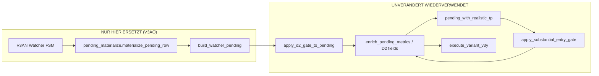

# L1 V3AO — Integration Touch-Watcher in L1-V3AK (nur Entry-Erkennung)

**Scope:** Forschung, isoliert. **Unverändert:** `run_l1_pilot.py`, `substantial_entry_gate_v3ak/run_v3ak.py`, P17, Produktionspfade.

**Snapshot:** SHA256 `b0718d82a94e8ad12d27d570c0cd7ce97cf8088a2db21c4c92830cd80fc600cb`.

---

## 1. Analyse der originalen L1-V3AK-Pipeline

| Stufe | Modul / Funktion | Rolle |
|---|---|---|
| SSOT-Kontext | `v3ab_context.build_context_from_snapshot` | Frozen Drawings, Candles, Fenster |
| **Entry-Erkennung (ersetzbar)** | `run_l1_pilot.build_pilot_context` | `build_touch_events` → C1 → Pending-Zeilen |
| Pool/D2 | `pool_d2_metrics.apply_d2_gate_to_pending` | 5m-PD1 ACTIVE, D2-Bänder, TP-Vorauswahl |
| Metriken | `pilot_engine.enrich_pending_metrics`, `enrich_d2_channel_filter_fields` | Kanalraum, V3E-B-Felder |
| Realistischer TP | `v3ah_tp.pending_with_realistic_tp` | CAP6_D20_BLOCK |
| Entry-Gate | `substantial_entry_gate.apply_substantial_entry_gate` | E0–E3 (Forschung: E3) |
| Ausführung | `support_break_exit_v3y.engine.execute_variant_v3y` | 1-Long, chronologisch |
| Exit-FSM | `support_sim.simulate_exit_v3y` | SL, Pool-TP, Kanal, SBE |

**V3AK-Runner:** `run_v3ak.py` — schleift nur über `ENTRY_GATE_SPECS`; ändert nichts an Exit-Engine.

---

## 2. Exakter Integrationspunkt

**Regel:** Der Watcher liefert nur `(touch_idx, confirm_idx, entry_idx)`; **Pool-SSOT** bleibt `pools_at_confirm_open(confirm_bar_open)` wie in `build_pilot_context` — kein Pool „aus der Zukunft“.

**Config:** `touch_watcher_research_v3an/watcher_config.TouchWatcherConfig` (Default-Touch **0,03 %**, Confirm **A2**, Fenster **12**).

**Szenario A / B:** `confirmation_mode ∈ {A1, A2, A3, LEGACY_C1, B_RECLAIM}` — getrennte Läufe, keine Mischlogik in einem Run.

---

## 3. Nachweis Wiederverwendung (keine duplizierte Exit-Engine)

| Komponente | V3AO-Implementierung |
|---|---|
| Exit / SL / TP / SBE | Import `execute_variant_v3y` (identisch zu `run_v3ak.py`) |
| D2 / ACTIVE / Qualifikation | Unveränderte `apply_d2_gate_to_pending` |
| V3E-B-Filter | Unverändert im Executor (`VARIANT_B`) |
| Substantial Gate | Unverändert `apply_substantial_entry_gate` |
| Gebühren/PnL | In `simulate_exit_v3y` (nicht kopiert) |

Neues Modul: `watcher_integration_v3ao/` + Runner `run_l1_pilot_watcher.py` (Projektroot `manual_channel_pool_long_v1/`).

---

## 4. Gleichheitstests (Pflicht vor historischem A/B)

Skript: `watcher_integration_v3ao/run_v3ao_equality_test.py`  
Artefakt: `l1_v3ao_equality_report.json`

| Test | Ergebnis |
|---|---|
| Doppel-Pipeline auf identischer Pending-Zeile | **PASS** (`te-d-c0791ea0c65e-0003`, `te-d-ea081434c5d3-0003`) |
| Rematerialisierung (Indizes → Row → D2) vs. Frozen | **PASS** |
| Rematerialisierung → Execute vs. Original-Row | **PASS** (Entry/Exit/PnL identisch) |
| V3AK E3 Trade-Count vs. `l1_v3ak_run_manifest.json` | **PASS** (3 Trades) |

**Interpretation:** Für **dieselben** Entry-Indizes und Confirm-Bar ist die komplette Downstream-Kette bitgenau wie V3AK reproduzierbar. Der Watcher darf nur andere Indizes liefern — nicht andere Exit-Logik.

---

## 5. Historischer Vergleich (erster Lauf)

`run_l1_pilot_watcher.py` · `l1_v3ao_vs_v3ak_comparison.csv` / `l1_v3ao_run_manifest.json`

| Variante | Kandidaten | Trades E3 | Σ gross % |
|---|---:|---:|---:|
| **V3AK-Baseline (C1/0,20 % Touch)** | 22 | **3** | **4,4766** |
| V3AO A2 W12 (0,03 %) | 31 | **2** | **4,7822** |
| V3AO A1 (0,03 %) | 31 | **2** | **4,7822** |
| V3AO B_RECLAIM (0,03 %) | 9 | **1** | **−1,2** |

Die Abweichung in **Kandidatenanzahl und Trade-Slots** ist **beabsichtigt** (nur Entry-Logik); Exits pro ausgeführtem Trade nutzen weiterhin dieselbe Engine.

---

## 6. Konflikte / Grenzen

| Thema | Status |
|---|---|
| Änderung an `run_l1_pilot.py` | **Keine** — Materialisierung ruft bestehende Funktionen |
| Änderung an V3AK | **Keine** |
| Touch über alle Linien im Snapshot | Watcher scannt wie Pilot **alle** `LineDef`; Struktur-Gate filtert nach `assess_long_touch_eligibility` |
| Chronologie / 1-Long | Unverändert im Executor — frühere Watcher-Entries konkurrieren um Slots wie bei V3AK |
| Performance | Vollscan pro Linie — für breiten Backtest Batch-Runner aus V3AN-Ergänzung empfohlen |

---

## 7. Nächste Schritte (Forschung)

1. `run_v3ao_equality_test.py` in CI/Manifest vor jedem Watcher-Backtest.
2. Parametergitter (Touch 0–0,20 %, A1/A2/A3, W6/W12/W24) über `TouchWatcherConfig` + `run_l1_pilot_watcher.py` erweitern.
3. Optional: Pending-Builder nur auf `PILOT_ALLOWED_LOWER_TREND_IDS` begrenzen (Parität mit Allowlist-Doku).
4. Chart-Overlay weiterhin nur aus Review-CSV; **kein** Merge in `run_l1_pilot`.

---

## 8. Artefakt-Index

| Datei | Zweck |
|---|---|
| `run_l1_pilot_watcher.py` | Haupt-Runner V3AO |
| `watcher_integration_v3ao/v3ao_context.py` | Kontext + Watcher-Pending + D2 |
| `watcher_integration_v3ao/v3ao_pipeline.py` | V3AK-Downstream |
| `watcher_integration_v3ao/pending_materialize.py` | Row-SSOT ab Confirm-Bar |
| `watcher_integration_v3ao/run_v3ao_equality_test.py` | Gleichheitstests |
| `touch_watcher_research_v3an/watcher_config.py` | Parametrisierung |

**STOP** — kein Produktions-Merge.
