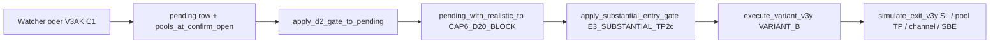

# L1 V3AW — Forensik: Kurze Take-Profits im V3AV-Backtest

**Modus:** READ-ONLY-Audit · **Keine Code-/Strategieänderungen**  
**Daten:** V3AV-Run `20261109T183302Z`, `l1_v3av_all_executed_trades.csv` (32 Zeilen)  
**Neue Artefakte (nur Auswertung):** `watcher_integration_v3aw/`

---

## Kurzantwort (5 Fragen aus Abschnitt 6)

| # | Frage | Antwort |
|---|--------|---------|
| 1 | Warum so viele nahe TP-Pools? | **V3AH `CAP6_D20_BLOCK`** wählt die **preislich nächste** Merge-Zone mit Distanz ≥0,5 % und ≤6 %, die gleichzeitig in der **D20-Dominanz** (Top 20 % ∫Density) liegt. In V3AV liegt diese „erste qualifizierte“ Zone oft **0,5–1,0 %** über dem Entry — nicht weil CAP/E3 sie kürzen, sondern weil **viele nahe Upper-D2-Bänder** existieren und nach Merge **eine nahe Zone D20-Rang 1–4** erhält. |
| 2 | Schon in V3AK implementiert? | **Ja.** V3AK/V3AO/V3AV nutzen dieselbe Konstante `CAP6_TP` / `TP_SCENARIO = "CAP6_D20_BLOCK"` (`v3ao_pipeline.py`, `v3ak_context.py`). |
| 3 | Watcher-Umbau TP verändert? | **Nein** (nur Entry-/Confirm-Pfad). Pflicht-Equality `run_v3ao_equality_test.py` vergleicht V3AK-Pipeline; Downstream = `pending_with_realistic_tp` → E3 → `execute_variant_v3y`. |
| 4 | Entspricht das der Strategieentscheidung? | **Ja, für den frozen V3AK-Stack:** dokumentierte Master-Audit-Entscheidung **V3E-B + CAP6_D20_BLOCK + E3** (`L1_V3AJ_CURRENT_STRATEGY_MASTER_AUDIT.md`). **Nicht** aktiv: V3AE „First Strong Upper Pool“ / TP2-Fernziele. |
| 5 | Welche Regeln erzeugen kleine Abstände? | (a) **Mindest-TP-Abstand 0,5 %** (`MIN_POOL_DIST_PCT` / `resolve_realistic_tp`); (b) **Auswahl aufsteigend nach Zonen-Unterkante** → **nächster** qualifizierter Pool, nicht stärkster; (c) **D20-Filter** schließt nahe Zonen mit schwacher ∫Density aus → kann Fern-TP erzwingen (Gegenbeispiel 10.08.); (d) **E3** filtert nur **Entry**, nicht TP. |

---

## 1. Aufrufkette (Watcher → Exit)



| Stufe | Modul / Funktion | Wirkung auf TP |
|--------|------------------|----------------|
| Pool-SSOT | `run_l1_pilot.pools_at_confirm_open` → `load_historical_pool_state_at_close` | Snapshot **nur bis Confirm-Bar-Close** (`pending_materialize.py` L108–110, `pool_decision_close`) |
| D2-Gate | `pool_d2_metrics.apply_d2_gate_to_pending` | Mindestens 1 qualifiziertes Upper-D2-Band (≥0,5 %); setzt **Baseline** `pick_tp` (wird von V3AH überschrieben) |
| **TP-Auswahl** | `v3ah_tp.apply_realistic_pool_tp` → `zone_density.resolve_realistic_tp` | **Ersetzt** TP durch CAP6+D20; Label `v3ah:CAP6_D20_BLOCK:<preis>` |
| E3 | `substantial_entry_gate.apply_substantial_entry_gate` | **Entry-Gate** (Merge-Zone ≤2,5 %, Width/Depth/Origins); **kein** TP-Patch |
| Executor | `support_break_exit_v3y/engine.execute_variant_v3y` | 1 Long; Exit nutzt `_pool_tp` |

**`v3ah:CAP6_D20_BLOCK` bedeutet:** Research-Szenario-Code aus `RealisticTPParams` — **CAP 6 %** maximale TP-Distanz vom Entry, **D20** = nur Zonen in den **stärksten 20 %** der gemergten Pool-Landschaft nach **integrierter D2-Density**; bei fehlender Zone **`NO_QUALIFIED_TP`** und Trade-Block (`no_tp_policy="BLOCK"`).

Implementierte Schwellen (`zone_density.py`):

```121:128:realistic_pool_tp_v3ah/zone_density.py
    by_price = sorted(scored, key=lambda r: r["zone"].bottom)
    for r in by_price:
        dist = r["dist_from_entry_pct"]
        if dist < 0.5 - 1e-9:
            continue
        if dist > cap_dist_pct + 1e-9:
            continue
        if not _dominance_ok(r, dominance):
            continue
```

- **Nicht** „stärkster Pool im CAP“, sondern **niedrigste Unterkante** unter D20+Cynthia.
- **Kein** Fern-Fallback wie V3AE `resolve_tp2` / `max D2` (`L1_V3AJ` Teil B §4 B vs C).

---

## 2. Früherer Forschungsstand (implementiert vs. diskutiert)

| Track | TP-Logik | Status in V3AV |
|-------|----------|----------------|
| **V3U–V3AB** | `pick_tp` — u.a. höchstes `lower_bound` qualified band / Kanal | Nur **Zwischenstand** in D2-Gate-Feldern; **finaler TP = V3AH** |
| **V3AE** | `resolve_tp2` + Fallback max D2 („First Strong Upper Pool“) | **Nicht** im V3AK/V3AO-Pfad |
| **V3W** | ∫Density, Merge-Zonen, TP2-Grid | Basis für **D20-Ranking**, nicht für TP2-Zielwahl |
| **V3AH** | `CAP6_D20_BLOCK` (frozen Referenz ~+5 % bei passender Zone) | **Produktiv im Research-Stack** |
| **V3AK** | V3AH + **E3** Substantial Entry | **Identisch** in V3AV |
| Diskussion (V3AM) | „CAP6-TP-Distanz ≫ E3-Zone“ als Hypothese | **Nicht implementiert** |

V3AK-Bericht: *„Variante V3E-B · TP fix CAP6_D20_BLOCK (unverändert vs. V3AH)*“ — `L1_V3AK_SUBSTANTIAL_ENTRY_GATE_REPORT.md`.

---

## 3. Fallstudie 10.08.2026 (`d-8037f795d49c`)

Gleiche Trendlinie, **unterschiedliche Touch-Events**, **kausale Pool-Snapshots** am jeweiligen Confirm-Close.

### A) Watcher A2 — 15:50 UTC (TP +0,5606 %)

| Feld | Wert |
|------|------|
| Event | `te-d-8037f795d49c-0003` |
| Entry | 0,069570 |
| Confirm / Pool-DC | 15:45 / **15:50 UTC** |
| Qualif. Upper-D2-Bänder | 127 ACTIVE |
| Merge-Zonen | 17 |
| Gewählte Zone | **0,06996–0,07023** (Rank **3**, D20 ✓, ∫D≈0,00104) |
| Legacy `pick_tp` (nur Referenz) | 0,07999 (~+14,9 %) — **wird von V3AH nicht verwendet** |

**Warum nah?** Preislich erste Merge-Zone ≥0,5 % **erfüllt D20** (bei 17 Zonen: Cut Rang ≤4). Viele Micro-Bänder ab 0,06996 bilden eine **nahe, density-starke** Zone.

### B) Watcher A2 — 22:15 UTC (TP +5,8655 %, Exit SL)

| Feld | Wert |
|------|------|
| Event | `te-d-8037f795d49c-0008` |
| Entry | 0,069730 |
| Confirm / Pool-DC | 22:10 / **22:15 UTC** |
| Qualif. Upper-D2-Bänder | 118 ACTIVE |
| Gewählte Zone | **0,07382–0,07418** (Rank **3**, D20 ✓, dist **5,8655 %**) |

**Warum plötzlich weit?** Nächste Zone **0,07008** (≈0,502 %) existiert, aber **Density-Rang 5** → **`not_D20` (cut=4)**. Alle Zonen **0,07008–0,0734** scheitern an D20 trotz Nähe. Erste **preislich aufsteigende D20-Zone** innerhalb CAP6 ist **0,07382**.

Auszug Audit (`l1_v3aw_aug10_forensic.json` → `merge_zones_cap6_audit`):

- 22:15: `0.07008` — dist 0,50 % — **SKIP: not_D20 (rank 5)**
- 22:15: **SELECTED** `0.07382` — dist 5,87 % — rank 3, in_d20

**15:50:** dieselbe logische Kette, aber **0,06996** bereits Rank 3 / D20 → naher TP.

→ **Kein Regelwechsel zwischen den Trades**, sondern **geänderte Entry-Höhe + geänderte ∫Density-Ränge** am späteren SSOT-Zeitpunkt.

Vollständige Bandlisten und Zonen-Audit:  
`watcher_integration_v3aw/l1_v3aw_aug10_forensic.json`

---

## 4. Alle 32 Trades — TP-Distanz & Mechanik

| Bucket (TP-Abstand) | Anzahl | Σ gross % | Hit-Rate |
|---------------------|-------:|----------:|---------:|
| 0,50 – &lt;1,00 % | **21** | +12,36 | 90,5 % |
| 1,00 – &lt;2,00 % | 7 | +10,22 | 100 % |
| 2,00 – &lt;3,00 % | 0 | — | — |
| 3,00 – &lt;5,00 % | 0 | — | — |
| ≥5,00 % | **4** | −4,80 | 0 % (alle SL) |

- **Ø TP-Abstand (alle 32 Zeilen):** **1,51 %** (`l1_v3aw_tp_distance_distribution.json`)
- **21/32** in 0,5–1,0 %-Bucket — konsistent mit **„nächste D20-Zone knapp über 0,5 %-Floor“**
- **11/32** hatten **nähere** Merge-Zonen, die nur wegen **nicht-D20** übersprungen wurden (`l1_v3aw_all_trades_tp_selection_audit.csv`)

---

## 5. Rolle von CAP6 und E3

| Gate | Begrenzt TP-Distanz? |
|------|----------------------|
| **CAP6 (6 %)** | Nur **Obergrenze**; erzeugt **keine** Mindest-Fern-TP. 4 Trades nutzen 5,8–5,9 % (nahe CAP). |
| **E3** | Prüft **substanzielle nahe Merge-Zone für Entry** (≤2,5 % über Entry); **ändert `tp_price` nicht**. |
| **D2** | Qualifikation ≥0,5 %; separat von V3AH-Zonen-Merge. |

---

## 6. Artefakte

| Datei | Inhalt |
|-------|--------|
| `l1_v3aw_tp_distance_distribution.json` | Buckets + Ø-TP-Distanz |
| `l1_v3aw_aug10_forensic.json` | Pool-Snapshots + Zonen-Audit (3 Entries inkl. V3AK 13:40) |
| `l1_v3aw_all_trades_tp_selection_audit.csv` | Pro Trade: DC, Ränge, übersprungene Near-Non-D20-Zonen |

Pool-Member stammen aus dem **gleichen deterministischen Reload** wie V3AV (`load_live_research_context`, SHA `9db7d941…`) — **kein** neuer Backtest, **keine** zukünftigen Pools.

---

## 7. Fazit für Research Chart Review

Die „überraschend kurzen“ TPs sind **kein V3AV- oder Watcher-Bug**, sondern das **documented V3AH-Verhalten**: **nächste D20-Zone über 0,5 %**, statische Unterkante, **BLOCK** ohne Pool. Große TPs aus älteren Notizen stammen typischerweise von:

1. **`pick_tp` / V3AE-Logik** (nicht aktiv), oder  
2. **V3AH bei Landschaften**, wo die **nächste D20-Zone weit** liegt (CAP6-nah, ggf. SL), oder  
3. **Referenztrades** mit anderem Snapshot/Geometrie (V3AH-Report ~+5 % bei Zone 0,08929).

**STOP** — READ-ONLY.
