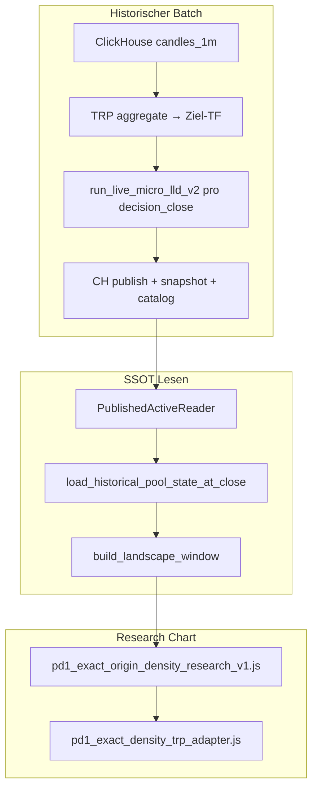

# PD1 — 1h-Timeframe-Pools in Research Charts

**Phase:** READ-ONLY Analyse + Implementierungsplan  
**Datum:** 2026-11-09  
**Scope:** Research Charts / historische LMV2 / Exact-Origin-Density — **keine Code-Änderung in dieser Phase**  
**Explizit ausgeschlossen:** 5m-PD1-Pipeline, L1-V3AK/AN–AX, P17, SHORT MAIN, Produktionsdienste

---

## Executive Summary

| Frage | Antwort |
|--------|---------|
| Gibt es **echte historische 1h-PD1-Pools** (wie 5m/15m frozen CH)? | **Nein** — keine `1h_PD1`-Importlinie, kein `pipeline_line_id` in `historical_lmv2_pd_contract_v1.py`. |
| Können 1h-Pools **live** berechnet werden? | **Ja** — `chart_live_micro_lld_v2` auf **aggregierten 1h-Kerzen** (1m→TRP `aggregate`, `strict_complete_buckets`). Das ist **kein** Ersatz für historische Publications. |
| Sind 5m-Pools auf 1h-Chart „falsch“? | Historisch geladene **5m-PD1**-Members sind **5m-slot-kausal**; auf 1h-Pane nur **Darstellungs-Mismatch**, keine 1h-Engine. |
| Unabhängiger Pool-TF-Selector? | **Heute nicht** — Exact-Origin-Density koppelt Pool-TF an **Pane-Candle-TF** (`activeScopesForPane`). |
| Empfehlung | Neue **eigenständige 1h-PD1-Publish-Pipeline** (CH) + Contract/UI-Entkopplung; **5m-Daten unangetastet** lassen. |

---

## 1. Aktueller PD1-Systemaufbau

### 1.1 Zwei Research-Pfade (wichtig unterscheiden)

| Pfad | Zweck | Pool-Zeitrahmen heute |
|------|--------|------------------------|
| **A — Exact Origin-Density (B)** | Kanonische PD1-D2-Density, L1-Backtest-SSOT | **5m** oder **15m** (frozen); **PD1 nur** in Release-Matrix |
| **B — Historical LLD V2 (älter)** | ACTIVE/Remaining Micro-Strength-Overlays | **DOGEUSDT 15m PD10** fest verdrahtet in `research_charts.js` |

L1-Forschung nutzt **Pfad A** (`load_historical_pool_state_at_close`, 5m PD1 @ Confirm-Close).

### 1.2 Berechnung & Speicherung (frozen / historisch)



**Kerndateien:**

| Funktion | Pfad |
|----------|------|
| SSOT @ decision close | `research_charts/historical_pool_state_v1.py` → `load_historical_pool_state_at_close` |
| TF×PD Contract | `research_charts/historical_lmv2_pd_contract_v1.py` |
| Landscape-Fenster (Viewer-API) | `pd1_landscape_viewer_v1/historical_window_v1.py` → `build_landscape_window` |
| CH Publications lesen | `live_micro_lld_v2_ch_test/active_snapshot/published_reader.py` |
| Historical Remaining | `phase11u_b/adapter.py` → `load_historical_remaining` |
| D2 Exact Bands (Chart) | `static/js/research/pd1_exact_density_trp_adapter.js` → `computeExactBandsForSide` |
| D2 Exact Bands (L1 Python) | `manual_channel_pool_long_v1/pd1_exact_d2_adapter.py` |
| CH Kerzen (Research) | `research_charts/clickhouse_source.py` → 1m FINAL + `aggregate(..., strict_complete_buckets=True)` |

**Unterstützte historische Viewer-Scopes** (`ALLOWED_VIEWER_SCOPES`):

- `(5m, PD1|5|10)`, `(15m, PD1|5|10)`, `(4h, PD10)`  
- **Kein `(1h, PD1)`**

**Pipeline-Line-IDs (PD1):**

```31:34:research_charts/historical_lmv2_pd_contract_v1.py
_PD1_LINE_BY_TIMEFRAME: dict[str, str] = {
    "15m": "historical_mixed_frozen_doge_apr_sep_2026_v1_15mpd1_v1",
    "5m": "historical_mixed_frozen_doge_apr_sep_2026_v1_5mpd1_v1",
}
```

**Import-Artefakte (Apr–Sep 2026, DOGE):**  
`live_micro_lld_v2_ch_test/doge_apr_sep_2026_v1_history/production/results/2026-09/`

- `5m_PD1`, `5m_PD5`, `5m_PD10`
- `15m_PD1`, `15m_PD5`, `15m_PD10`
- `4h_PD10`  
- **Kein** `1h_PD1`

### 1.3 ACTIVE, Remaining, Exact-Origin-Density

| Konzept | Implementierung |
|---------|------------------|
| **ACTIVE @ t** | Pool-Segmente in `active_members` / `segments` mit `[known_at, break_at]`; Chart: `poolActiveAt(pl, t)` |
| **Decision close** | Kausales Slot-Ende: `membership_slot_minutes(tf)` → UTC-Raster (5/15/240 Min) |
| **Historical Remaining** | `load_historical_remaining(..., include_remaining=True)` — projiziert invalidierte Segmente; kausal gebunden an frozen candle snapshot hashes |
| **Exact-Origin-Density** | Preis-Sweep über ACTIVE-Pool-Grenzen; **depth = unique origin count** pro Band (`computeExactBandsForSide`) — **kein** Micro-Strength |
| **Lookahead** | `include_remaining=False` im L1-Backtest; Publications nur bei `publish_complete=1` |

### 1.4 Depth-Slider (Research Chart)

- UI: `researchExactOriginMinDepth` in `templates/research_charts.html`  
- Logik: `pd1_exact_origin_density_research_v1.js` — filtert **nur Darstellung** (min. unique origins), **keine** SSOT-Änderung  
- Persistenz: `MIN_ORIGINS_STORAGE_KEY` (localStorage)

### 1.5 Live-Pfad (nicht-historisch)

`POST /api/research/live-micro-lld-v2` → `chart_live_micro_lld_v2.py`:

- Timeframes: `1m, 5m, 15m, 30m, 1h, 4h`
- Engine: `run_live_micro_lld_v2` auf **nativem** `load_candles(symbol, tf, …)`  
- **As-of** über `pools_as_of` — für Replay nutzbar, aber **nicht** identisch mit frozen CH-Publications.

---

## 2. Echte 1h-PD1-Pools — Bestand

### 2.1 Ergebnis: **keine frozen 1h-PD1-Linie**

- Kein `1hpd1` in Repo/Import-Tree (Shell-Suche leer).
- Contract blockiert `1h` + PD1 (`_PD1_LINE_BY_TIMEFRAME` ohne `1h`).
- `membership_slot_minutes()` wirft für `1h` — nur `5m|15m|4h`.

### 2.2 Was existiert stattdessen?

**Live-Rechnung auf 1h-Kerzen** (echte Engine-Parameter PD*, aber **ohne** historische Publish-Kette):

- Warmup skaliert mit `tf_sec` (1h = 3600s).
- Pool-IDs/Origins stammen aus **Live-Engine-Lauf**, nicht aus `pipeline_line_id=…1hpd1…`.

**Fazit:** Anzeige von 5m-PD1-Density auf einem **1h-Pane** wäre aktuell entweder **fehlgeschlagener Scope** oder **falsche Semantik** (5m-Membership an 1h-Chart ohne explizite Entkopplung).

### 2.3 Was wäre eine **eigenständige** 1h-PD1-Pipeline?

Parallele Schicht zu `5m_PD1` / `15m_PD1`:

1. **Kerzen:** `ClickHouseResearchCandleSource.get_candles(DOGEUSDT, "1h", …)` — 1m→aggregate, **nur geschlossene** 1h-Buckets.
2. **Engine:** `LiveMicroLldV2Config(pool_detail=1)` — gleiche **PD1-Preset-Parameter** wie Phase-5V, aber **eigener** `config_hash`-Kontext dokumentieren (Inputs ≠ 5m).
3. **Batch:** Entlang **1h decision closes** (UTC `:00:00` bar close) Apr–Sep 2026 publisieren.
4. **Neue Line-ID** z. B. `historical_mixed_frozen_doge_apr_sep_2026_v1_1hpd1_v1`.
5. **CH:** `TABLE_PUBLISH`, `TABLE_SNAPSHOT_META`, `TABLE_ACTIVE_POOL` wie bestehende Linien.
6. **Contract:** `("1h", 1)` in `ALLOWED_VIEWER_SCOPES` + `_PD1_LINE_BY_TIMEFRAME["1h"]`.

**Nicht zulässig:** 5m-Publications auf 1h-Chart „hochrechnen“ oder 5m-Bänder als 1h-Origins labeln.

---

## 3. Datenbasis & Kausalität

### 3.1 DOGEUSDT 1h-Kerzen

| Quelle | Verhalten |
|--------|-----------|
| `clickhouse_source.py` | SSOT **1m** `is_closed=1` FINAL; HTF via TRP `aggregate(..., strict_complete_buckets=True)` |
| `service.load_candles` | Unterstützt `1h` in `SUPPORTED_TIMEFRAMES` / `DEFAULT_LIMIT_BY_TF["1h"]=2200` (~92d) |
| Unvollständige 1h | `strict_complete_buckets` → **kein** Bucket ohne vollständige 1m-Füllung |
| UTC-Grenzen | TRP `timeframe_seconds("1h")` = 3600; Decision-Close muss **1h-Slot** sein (neu: `membership_slot_minutes("1h")=60`) |

### 3.2 Historische Verfügbarkeit

- **Frozen Pools:** Apr–Sep 2026 Import **nur** 5m/15m/4h — **kein** 1h-Bestand.
- **1h-Kerzen:** prinzipiell aus CH ableitbar über gesamten 1m-Coverage (Research-Window ≠ automatisch = Pool-Import-Fenster).
- **Kausalität:** Gleiches Modell wie 5m — nur `decision_close ≤ as_of`; `PublishedActiveReader` FINAL-Gates.

### 3.3 L1-Backtest (unverändert lassen)

`run_l1_pilot.pools_at_confirm_open` → weiterhin **`timeframe=5m`, `pool_detail=1`**.  
1h-PD1-Chart ist **orthogonal** bis explizite L1-Phase (separates Ticket).

---

## 4. Research-Chart: unabhängiger Pool-Timeframe

### 4.1 Ist-Zustand (Kopplung)

`pd1_exact_origin_density_research_v1.js`:

- `activeScopesForPane(pane)` → `timeframe: paneChartTimeframe(pane)`  
- Template-Hinweis: *„Timeframe = Chart-Pane“*  
- `RELEASED_VIEWER_SCOPES` **ohne** 1h.

**Folge:** 5m-Pane → nur 5m-Pools; 1h-Pane → **kein** released PD1-Scope (oder fälschlich Live-Pfad).

### 4.2 Soll: vier Kombinationen

| Candle-TF | Pool-TF | Machbarkeit (nach Plan) |
|-----------|---------|-------------------------|
| 5m | 5m | ✅ heute |
| 5m | 1h | 🔜 nach 1h-Publish + UI-Entkopplung |
| 1h | 1h | 🔜 wie oben |
| 1h | 5m | 🔜 UI-Entkopplung (5m-Daten existieren) |

**UI-Vorschlag:**

- Neuer Selector `researchPoolTimeframe` (`5m` | `1h` für PD1; später optional `15m`).
- API `POST /live-charts/viewer/api/window` Body: **`pool_timeframe`** getrennt von Pane-`timeframe` (Pane nur für Kerzen).
- Sichtbares Badge: `PD1 · Pool 1h` vs `Candles 5m`.

### 4.3 Adapter-Anpassungen (Plan)

`pd1_exact_density_trp_adapter.js`:

- `membershipSlotMinutesForTimeframe("1h")` → **60**
- `causalDecisionCloseMs` mit 60-Min-Slots
- `exactOriginScopeKey(timeframe, pool_detail)` — **nie** Pane-TF verwechseln

`build_landscape_window`:

- `membership_slot_minutes("1h")=60` in Python-Contract
- Sweep-Raster: heute **5m-Schritte** mit Mapping auf 1h-DC — beibehalten oder 1h-Grid-Optimierung (Performance)

---

## 5. Density & Darstellung (Wiederverwendung)

- **Gleiche** Renderer: TRP-Overlays, Farbpaletten `LOWER_RGB`/`UPPER_RGB`, Depth-Buckets, Min-Origins-Slider.
- **Pool-Lifetime / Remaining:** gleiche `segments`-Struktur aus SSOT.
- **Replay/As-of:** unverändert über Viewer-Fenster + Publication-Index.
- **Labeling:** Overlay-Metadaten `pool_timeframe: "1h"`, `pipeline_line_id`, `config_hash` in API-Response (für Debug).

**Origin-ID-Trennung:** Scope-Key `1h\x1f1` vs `5m\x1f1`; getrennte Caches in `inflight` Map (`pd1_exact_origin_density_research_v1.js`).

---

## 6. Technische Risiken

| Risiko | Bewertung | Mitigation |
|--------|-----------|------------|
| PD1-Parameter timeframeabhängig? | **Ja** indirekt — gleiches `LiveMicroLldV2Config(1)`, aber **andere Kerzen** → andere Pools | Eigene `pipeline_line_id` + dokumentierter Hash; keine 5m-IDs wiederverwenden |
| Historische 1h ACTIVE rekonstruierbar? | **Nur nach Full-Import** | Batch wie `5m_PD1`; Gap-Tests auf CH |
| DB/API | Neue publish rows; Contract-Erweiterung | Kein Schema-Break; additive line_id |
| Performance | Weniger DCs, aber 168h Warmup × 1h = große 1m-Reads | Batch prefill; optional 1h-native candle cache |
| 5m/1h-Vermischung | **Hoch** ohne UI/Scope | Fail-closed `resolve_viewer_historical_scope`; getrennte scope keys |
| L1 / 5m-Forschung | **Null-Risiko** wenn SSOT-Pfad unberührt | Kein Default-Wechsel in `pools_at_confirm_open` |

---

## 7. Implementierungsplan (Phasen, noch nicht ausführen)

### Phase 0 — READ-ONLY Abnahme (dieses Dokument)

- [x] Ist-Analyse
- [ ] Review Freeze-Bedarf mit Owner

### Phase 1 — Datenproduktion 1h-PD1 (Research/CH only)

| Schritt | Aktion | Dateien / Orte |
|---------|--------|----------------|
| 1.1 | Runbook: 1h decision grid DOGE Apr–Sep 2026 | `live_micro_lld_v2_ch_test/historical_json_import/docs/` (neu) |
| 1.2 | Batch-Runner analog `5m_PD1` | bestehende `historical_json_import/` Scripts (Pattern kopieren, **neue** line_id) |
| 1.3 | CH Publish + Integrität | `catalog_integrity.py`, `published_reader.py` (unverändert nutzen) |
| 1.4 | Ergebnisordner `1h_PD1/` | unter `doge_apr_sep_2026_v1_history/production/results/` |

### Phase 2 — Contract & SSOT

| Schritt | Datei |
|---------|--------|
| 2.1 | `historical_lmv2_pd_contract_v1.py` — `("1h",1)`, `_PD1_LINE_BY_TIMEFRAME["1h"]`, `membership_slot_minutes("1h")=60` |
| 2.2 | Tests erweitern | `tests/test_historical_lmv2_pd_contract_v1.py` |
| 2.3 | `load_historical_pool_state_at_close(..., timeframe="1h")` Smoke | `tests/test_historical_pool_state_v1_contract.py` |

### Phase 3 — Viewer / Chart (Research only)

| Schritt | Datei |
|---------|--------|
| 3.1 | Pool-TF Parameter API | `pd1_landscape_viewer_v1/api.py`, `window_service_v1.py` |
| 3.2 | `build_landscape_window` — 1h slot + Tests | `historical_window_v1.py`, `test_pd1_5m_viewer_integration_v1.py` (neues `test_pd1_1h_*`) |
| 3.3 | JS: `RELEASED_VIEWER_SCOPES` + Entkopplung Pane vs Pool | `pd1_exact_origin_density_research_v1.js`, `pd1_exact_density_trp_adapter.js` |
| 3.4 | UI Selector + Badge | `templates/research_charts.html`, `research_charts.js` |
| 3.5 | Capabilities endpoint dokumentieren | `pd1_landscape_viewer_v1/api.py` `/capabilities` |

### Phase 4 — Validierung

| Test | Ziel |
|------|------|
| Publication parity | Jede 1h-DC in Range hat `publish_complete=1` |
| No lookahead | Remaining @ t enthält keine Pools mit `known_at > t` |
| Origin scope | Gleichzeitig 5m+1h overlay — unterschiedliche `pipeline_line_id`, kein Cache-Bleed |
| Visual smoke | DOGE: 5m candles + 1h pools vs 1h+1h |
| L1 regression | `run_v3ao_equality_test` / Pilot unverändert PASS |

### Phase 5 — Optionale Forschung (später, separates Ticket)

- L1 `pool_timeframe` Schalter — **nicht** Teil dieser Chart-Phase.
- Backtester `pools_at_confirm_open(timeframe=…)` — nur nach expliziter Strategie-Entscheidung.

---

## 8. Testplan (Kurz)

1. **Unit:** Contract allows `(1h,1)`; rejects `(1h,5)` unless später definiert.  
2. **Integration:** `build_landscape_window(..., timeframe="1h", pool_detail=1)` für 24h-Fenster in Aug–Sep.  
3. **Density parity:** JS `computeExactBandsForSide` vs Python `pd1_exact_d2_adapter` Stichprobe @ 1h DC.  
4. **UI:** Selector wechselt API-Parameter, **nicht** Pane-TF.  
5. **Regression:** Bestehende `5m_PD1`-Publikationszählung unverändert (Apr-Regression aus Phase-4w-Docs).

---

## 9. STOP

**Keine Implementierung in dieser Phase.**  
Keine Änderung an 5m-PD1-Pipeline, L1-Backtestern, P17, SHORT MAIN oder Produktionsdiensten.

**Nächster Schritt (nach Freigabe):** Phase 1 Batch-Runbook + `1hpd1` pipeline_line_id in Staging-CH.
