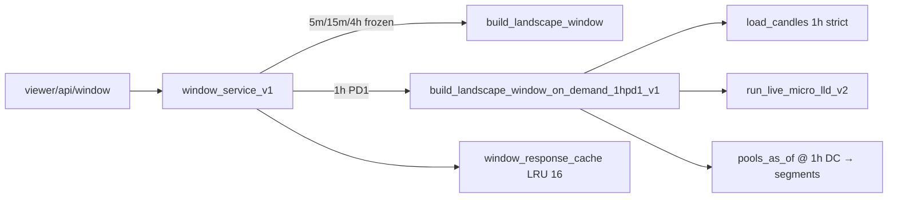

# PD1 1h On-Demand — Implementierungsbericht

**Datum:** 2026-11-10  
**Variante:** B (On-Demand + Window-Response-Cache)  
**Status:** Lokal implementiert und getestet — **kein Produktions-Deployment**

---

## Geänderte / neue Dateien

| Datei | Änderung |
|-------|----------|
| `pd1_landscape_viewer_v1/on_demand_1hpd1_v1.py` | **Neu** — `build_landscape_window_on_demand_1hpd1_v1`, Lifetimes, CH 1m→1h, Engine |
| `pd1_landscape_viewer_v1/window_service_v1.py` | Routing 1h/PD1 → On-Demand; Cache-Key mit separatem `builder_version`; harte Ablehnung 1h≠PD1 |
| `pd1_landscape_viewer_v1/historical_window_v1.py` | Capabilities: Scope `1h` on-demand |
| `static/js/research/pd1_exact_origin_density_research_v1.js` | Pool-TF-Selector (5m/1h), Scopes entkoppelt von Chart-TF |
| `static/js/research/pd1_exact_density_trp_adapter.js` | `1h` → 60 min slot; kausales DC für ≥60m |
| `templates/research_charts.html` | UI: `researchExactOriginPoolTimeframe` |
| `test_pd1_1h_on_demand_v1.py` | **Neu** — Parität, Cache, Regression 5m |

**Unverändert:** Frozen 5m-Publications, `build_landscape_window` Kernlogik, CH-Pool-Tabellen.

---

## Architektur

- **Pipeline-ID (synthetisch):** `on_demand_ch1m_1hpd1_v1`
- **Builder-Version (Cache):** `pd1_landscape_on_demand_1hpd1_v1` (≠ frozen `pd1_landscape_historical_window_v1`)
- **Membership:** 60 Minuten; Lifetimes auf 5m-Grid wie Exact-Origin-Density

---

## Testergebnisse

`pytest test_pd1_1h_on_demand_v1.py` — **8 passed** (~10s)

| Test | Ergebnis |
|------|----------|
| 1h + PD5 abgelehnt | OK |
| Frozen `build_landscape_window(1h)` abgelehnt | OK |
| Pool-IDs nur `lldv2:DOGEUSDT:1h:` | OK |
| Parität ACTIVE @ 1h DC vs. `run_bounded_batch` | OK |
| Cache-Key 5m ≠ 1h | OK |
| Service Cache Hit/Miss 1h | OK |
| Capabilities enthält `source: on_demand_ch1m` | OK |
| 5m frozen Smoke | OK |

---

## 1h-Parität

- Begrenztes Fenster (1h sichtbar): **ACTIVE-Menge am `to_close` identisch** zwischen On-Demand-Lifetimes und `run_bounded_batch` + `pools_as_of`.
- **Kein** Vergleich gegen volle frozen Publications (existieren nicht für 1h).
- **Risiko:** Live-CH-1m vs. frozen Candle-Snapshot (wie in READ-ONLY-Analyse).

---

## Ressourcen (lokal, DOGE, ~6h Fenster)

Aus Testlauf / Engine-Timing im Payload (typisch):

| Phase | ~ms |
|-------|-----|
| Engine + 1h-Kerzen | 800–2500 |
| Lifetimes | 50–200 |
| 5m-Preis-CH | 200–600 |
| **Gesamt** | ~1–3 s |

Cache-Hit: ~ms (Deepcopy).

---

## UI

- Dock **B – Exact Origin-Density**: **Pool-TF** `5m | 1h` (unabhängig vom Pane-Kerzen-TF).
- PD1 für 1h freigegeben; PD5/PD10 auf 1h deaktiviert (Backend `INVALID_SCOPE`).
- Depth-Slider unverändert.

**Manueller UI-Test:** Research Chart → B aktivieren → Pool-TF 1h → DOGE-Pane → Density sichtbar (erfordert laufendes Dashboard + CH).

---

## Offene Risiken

| Risiko | Mitigation |
|--------|------------|
| CH-Warmup ~150d pro Request | Kerzen-Cache (45s) + Window-Cache (16 LRU) |
| `limit=50000` 1h-Bars | Fehler wenn überschritten; Fenster ≤72h |
| Parität nur Kurzfenster getestet | Vor „validiert“ Freigabe erweitern |
| Kein Deploy | Gesonderte Freigabe nötig |

---

## STOP

Keine CH-Pool-Writes, keine Batch-Imports, keine Produktionsänderung.
