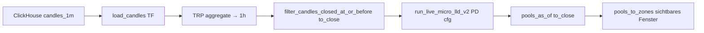

# PD1 1h — Ressourcenschonende historische Pool-Anzeige (READ-ONLY)

**Phase:** Analyse only — keine Implementation, keine CH-Schreibvorgänge, keine Batch-Imports  
**Datum:** 2026-11-09  
**Bezug:** Ergänzt `L1_PD1_1H_TIMEFRAME_ANALYSIS_AND_PLAN.md`  
**Scope:** Research Charts, Exact-Origin-Density D2, Live-Engine `chart_live_micro_lld_v2`  
**Unverändert lassen:** 5m-PD1-Publications, L1, P17, Produktionsdienste

---

## Executive Summary

| Frage | Kurzantwort |
|--------|-------------|
| Historische **1h-PD1** ohne neue dauerhafte Poolhistorie? | **Ja, für Research-UI**, wenn On-Demand dieselbe Engine + 1m→1h-Aggregation wie Live nutzt und Density-Lifetimes aus **einem** kausalen Engine-Lauf abgeleitet werden (nicht nur `pools_as_of` am Fensterende). |
| Wenigster Speicher | **Variante A** (kein zusätzlicher CH-Pool-Speicher). |
| Beste Geschwindigkeit + Genauigkeit (praktisch) | **Variante B** (On-Demand + bestehender Window-Response-Cache) — CH-Kerzen sind der Hauptkostenfaktor (~220k 1m-Zeilen / ~1,1s); Engine ist nach aktueller Messung negligible (~50ms). |
| Parität zu frozen Publications | **Nicht garantiert ohne Verifikation** — gleiche Engine-Kausalität ja, aber frozen Imports pinen **immutable Candle-Snapshots** + `config_hash`; Live-CH-1m kann abweichen. |

---

## 1. Bestehende 1h-Berechnung (`chart_live_micro_lld_v2`)

### 1.1 Datenfluss (Live-Pfad, wiederverwendbar historisch)



Kernmodule:

| Schritt | Modul | Relevanz historisch |
|---------|--------|---------------------|
| Kerzen | `research_charts/service.py` → `load_candles` | Lädt 1m, aggregiert Ziel-TF (inkl. `1h`) |
| As-of / kein Lookahead | `indicators/live_micro_lld_v2/as_of.py` | `filter_candles_closed_at_or_before`, `pools_as_of` |
| Engine | `indicators/live_micro_lld_v2/engine.py` | `run_live_micro_lld_v2` |
| Research-API | `research_charts/chart_live_micro_lld_v2.py` | Warmup + ein Snapshot am `to_close` |

Warmup (PD1) in `chart_live_micro_lld_v2`:

```python
warmup_bars = volume_lookback + swing_len + 64  # PD1: 3500 + 30 + 64 = 3594 (1h-Bars)
load_start = from_unix - warmup_bars * tf_sec
```

### 1.2 Checkliste (Anforderungen)

| Anforderung | Status im Live-Pfad | Hinweis |
|-------------|---------------------|---------|
| Echte 1h aus 1m | **Ja** | Aggregation über TRP in `load_candles` |
| `strict_complete_buckets=True` | **Ja** (Research-CH-Quelle / Aggregate-Pfad wie Live-Test-Batch) | Gleiches Muster wie `live_micro_lld_v2_ch_test/batch.py` |
| PD1-Parameter | **Ja** | `LiveMicroLldV2Config(pool_detail=1)` / Preset volume_lookback=3500 |
| Deterministische Origin-IDs | **Ja** | `lldv2:{symbol}:{timeframe}:…:{anchor_unix}` in `models.py` — **timeframe im ID** verhindert 5m/1h-Vermischung |
| ACTIVE kausal rekonstruieren | **Teilweise** | `pools_as_of(t)` pro Zeitpunkt ist kausal; **aktuelle API** liefert nur **einen** Snapshot am Fensterende |
| Keine Zukunft | **Ja** | Kerzenfilter + `known_at > as_of` ausgeschlossen |
| Exact-Origin-Density D2 | **Nicht out-of-the-box** | Density braucht **Lifetimes/Segments** über die Zeit; siehe Abschnitt 4 |

### 3. READ-ONLY-Messung (begrenzt, DOGEUSDT, Aug-2026, 72h sichtbar + PD1-Warmup)

| Metrik | Wert |
|--------|------|
| PD1-Warmup | 3594 × 1h ≈ **150 Kalendertage** |
| ClickHouse 1m-Zeilen (Warmup+72h) | **220 021** |
| Aggregierte 1h-Bars | **3667** |
| CH fetch + Pack | **~0,72–1,09 s** |
| 1m→1h aggregate | **~0,21 s** |
| `run_live_micro_lld_v2` (gesamter Prefix) | **~0,05 s** |
| Pools im Engine-Output | **2528** (ACTIVE-Filter am `vis_to` über `pools_as_of`) |

**Fazit Ressourcen:** Für typisches Viewer-Fenster (≤72h) dominiert **CH-Lesen von ~150d 1m-Daten**, nicht die Engine. RAM: Größenordnung **~50–150 MB** pro Request (1m-Packed + 1h-Candles + Pool-Liste) — abhängig von Python/ClickHouse-Client.

**Limit:** `load_candles(…, limit=50000)` — für 1h+PD1 reicht das für Warmup+72h (~3666 Bars); **längere sichtbare Fenster** oder andere TFs können die Grenze erreichen (analog Batch-Code).

---

## 2. Varianten A / B / C

### Variante A — On-Demand (keine persistente Poolhistorie)

**Idee:** Pro Viewer-Request: 1m aus CH → 1h → ein kausaler `run_live_micro_lld_v2` von `load_start` bis `vis_to`; daraus Pool-Lifetimes für D2-Sweep bauen; **keine** neuen CH-Pool-Tabellen.

| Dimension | Abschätzung |
|-----------|-------------|
| Zusatz-CH-Speicher Pools | **0** |
| RAM pro Request | **~50–150 MB** (s. Messung) |
| CPU | **1× Engine-Lauf** + Segment-Build; Engine << CH |
| Typische Latenz (72h-Fenster) | **~1–3 s** (CH+Agg+Engine; Netzwerk/CH-Load variiert) |
| Warmup | **~150d 1m** calendar — **nicht** nur 168h Landscape-Warmup |
| Wiederholte Anfragen | Jedes Mal CH (unless Service-Candle-Cache, TTL 45s, max 48 Keys) |
| Längere Zeiträume | Viewer-Cap **72h** (`MAX_EXPORT_HOURS`); länger = mehrere Requests / UX-Split |

**Zusatzarbeit vs. heutige `chart_live_micro_lld_v2`:** Lifetimes-Format wie `build_landscape_window` (`segments`, `origin` via `_origin_logical_v2_key`), nicht nur Zonen am End-Snapshot.

### Variante B — On-Demand + Cache

Wiederverwendung vorhandener Muster:

| Cache | Ort | Default | Wirkung für 1h |
|-------|-----|---------|----------------|
| Kerzen | `service.py` | 48 Einträge, TTL 15s (Symbol) / **45s** (History) | Identische Fenster innerhalb TTL = kein CH |
| Landscape-Response | `window_response_cache_v1.py` | **16** Einträge (`PD1_WINDOW_RESPONSE_CACHE_MAX` max 64), LRU, **kein TTL** (nur Eviction) | Cache ganzer Window-Payload inkl. `pools[]` |
| Member-Cache (5m frozen) | `historical_window_v1._load_members` | pro Request in-process | Für 1h On-Demand **ersetzen** durch Engine-Lifetimes, nicht CH-Member-Loads |

| Dimension | vs. A |
|-----------|-------|
| Speicher | + **~5–50 MB pro gecachtem Window** (Payload-Tiefe kopiert; abhängig von Pool-Anzahl/Segments) |
| Latenz (Cache-Hit) | **~ms–100ms** (Deepcopy) |
| Genauigkeit | Identisch zu A bei gleichem Inputsnapshot |
| Risiko | Stale Cache wenn CH-1m nachgezogen wird — analog heute; Keys sollten `builder_version` + optional `engine_version` tragen |

**Empfehlung TTL für 1h On-Demand-Cache:** zusätzlich zu LRU z. B. **300–900s** optional (nicht in frozen 5m-Cache nötig, weil Publications immutable sind).

### Variante C — Historische Publications (wie 5m/15m)

**Idee:** Phase-5-Pipeline: pro **1h decision_close** Engine-Lauf, ACTIVE in ClickHouse, `pipeline_line_id` in `historical_lmv2_pd_contract_v1.py`.

| Dimension | Abschätzung |
|-----------|-------------|
| CH-Speicher Pools | **Groß** — für 5m PD1 über Apr–Sep existieren bereits Millionen Member-Zeilen; 1h hat ~1/12 Slots, aber **pro Slot mehr Pools aktiv** (längere Bars) → Größenordnung **10²–10³ GB** nicht ausgeschlossen ohne Inventur — **deutlich > A/B** |
| Import-CPU | Einmalig hoch; Landscape-Reads dann wie heute 5m (Batch-Prefill) |
| Query-Latenz Viewer | **Niedrig** bei Hit (bewährt bei 5m) |
| Genauigkeit | **SSOT** für L1-Parität, **wenn** Candle-Snapshot frozen + gleicher `config_hash` |
| Aufwand | Neuer Import-Lauf, Contract-Erweiterung, QA — **explizit ausgeschlossen** in dieser Phase |

---

## 3. Ressourcenvergleich (Übersicht)

| Kriterium | A On-Demand | B + Cache | C Publications |
|-----------|-------------|-----------|----------------|
| Zusatz-CH-Pool-Speicher | Keiner | Keiner | Sehr hoch |
| RAM (typ. 72h-Request) | Mittel | Mittel (+Cache) | Niedrig am Request |
| CPU pro Request | CH + 1× Engine | Hit: minimal | CH Member-Reads |
| Erste vs. wiederholte Anfrage | Gleich teuer (CH) | Wiederholt billig | Billig |
| Warmup | ~150d 1m (PD1) | wie A | 168h + published grid (5m-Pfad heute) |
| Skalierung längere History | CH-Scan wächst mit `to` | wie A | Vorberechnet |
| Betriebskomplexität | Niedrig | Mittel | Hoch |

---

## 4. Historische Genauigkeit (On-Demand vs. Publications)

### 4.1 Was Exact-Origin-Density braucht

- Viewer liefert `pools[]` mit **`segments: [[t0,t1],…]`**, Sweep in 5m-Schritten (`pd1_exact_density_trp_adapter.js`, `STEP_MS = 5m`).
- Frozen-Pfad: `build_landscape_window` lädt **ACTIVE-Membership pro decision_close** aus CH (`load_historical_pool_state_at_close`), baut Intervalle (`_build_lifetimes`).
- `include_remaining` ist für Landscape **false** — D2 nutzt **ACTIVE only** (kein Remaining-Zwang für On-Demand).

### 4.2 Kann ein einzelner Engine-Lauf dieselben ACTIVE-Zustände liefern?

**Theoretisch ja (kausal):** Der Batch-Import führt pro `decision_close` die Engine auf dem Kerzenprefix bis `DC` aus. Ein **einmaliger** Lauf über `[load_start … vis_to]` plus `pools_as_of(DC)` an jedem **1h**-Slot sollte dieselbe ACTIVE-Menge liefern wie inkrementelle Prefix-Läufe, **wenn**:

- dieselben 1h-Kerzen (gleiche Aggregation, `strict_complete_buckets`),
- dieselbe Engine-Version und PD1-Config,
- `break_at`-Semantik = Ende der ACTIVE-Sichtbarkeit in Publications.

**Praktisch zu verifizieren:** Paritätstest (kleines Fenster): On-Demand-Lifetimes vs. hypothetischer Import — **noch nicht durchgeführt** (kein 1h frozen SSOT).

### 4.3 Abweichungsrisiken (technische Ursachen)

| Risiko | Beschreibung |
|--------|--------------|
| **Candle-SSOT** | Publications nutzen frozen Session; On-Demand live `candles_1m` — Korrekturen/Nachfüllungen ändern Pools |
| **Nur End-`as_of`** | Heutiges `chart_live_micro_lld_v2` ≠ D2 — **Lifetimes fehlen** |
| **Sweep vs. Slot** | UI sweept alle 5m; Membership bei 1h-Pools sollte zwischen 1h-DCs **stückweise konstant** sein (`membershipSlotMinutesForTimeframe` muss **60** für `1h` — heute fällt `1h` auf Default **15m** im Adapter) |
| **Daten-Grenzen** | Frozen 5m capped Apr–Sep; On-Demand 1h kann jedes CH-1m-Fenster nutzen — **Scope-Warnung** in UI nötig |
| **Remaining / Provenance** | Window-Response-Cache verlangt `pipeline_line_id` + `config_hash` — On-Demand braucht **synthetische Provenance** (`compute_mode: live_on_demand_1hpd1_v1`) |
| **5m-Vermischung** | Nur API/UI-Scope `timeframe: "1h"`; keine `historical_lmv2` 5m-Publication für 1h-Pane |

### 4.4 As-of-Semantik

- Kerzen: `bar_close ≤ as_of_close` (engine input).
- Pools: sichtbar wenn `known_at ≤ as_of` und (`break_at` null oder `break_at > as_of`).
- Density bei Zeit `t`: nur Pools mit Segment über `t` — äquivalent zu frozen zwischen zwei 1h-Publication-Slots, wenn Segmente aus `pools_as_of` pro 1h-DC erzeugt werden (alternativ: direkt `known_at`/`break_at` als ein Segment pro Pool — einfacher, wenn `break_at` nur bei echtem Break gesetzt wird).

---

## 5. Research-Chart-Integration (Pool-TF unabhängig von Candle-TF)

### 5.1 Ist-Zustand

- `pd1_exact_origin_density_research_v1.js`: `activeScopesForPane` = **Pane-Chart-TF × gewähltes PD**; nur Einträge in `RELEASED_VIEWER_SCOPES` (5m/15m/4h, **kein 1h**).
- Viewer ruft `build_landscape_window(timeframe=…)` — Auflösung über `historical_lmv2_pd_contract_v1.ALLOWED_VIEWER_SCOPES`.
- **5m-Funktionen unangetastet:** Neuer Scope + neuer Backend-Zweig, bestehende 5m-Calls unverändert lassen.

### 5.2 Ziel-UX

| Control | Verhalten |
|---------|-----------|
| Candle-TF | weiter unabhängig (1m/5m/15m/1h/…) |
| Pool-TF-Selector | **PD1 5m** \| **PD1 1h** (mindestens PD1) |
| Density | Pool-TF steuert Datenquelle; Sweep bleibt 5m-Auflösung (wie 15m/5m heute) |

### 5.3 Minimale Integrationspunkte

1. **UI:** `researchExactOriginPoolTimeframe` (oder Scope-Key) entkoppelt von `pane.tf`.
2. **JS:** `RELEASED_VIEWER_SCOPES` + `membershipSlotMinutesForTimeframe("1h") → 60`.
3. **API:** Neuer `compute_mode` (z. B. `live_on_demand_1hpd1_v1`) in `window_service_v1` / paralleler Builder.
4. **Capabilities:** `data_available_from/to` aus **CH-1m-Abdeckung**, nicht `static_timeline_import_bounds`.

---

## 6. Empfehlung

### 6.1 Beantwortung der Review-Fragen

1. **Ohne neue Poolhistorie möglich?** — **Ja** für Research-Darstellung und D2, mit On-Demand-Engine + Lifetime-Ableitung; L1-**SSOT-Parität** erst nach Verifikation oder Variante C.
2. **Wenigster Speicher?** — **Variante A**.
3. **Beste Speed/Accuracy-Kombination?** — **Variante B** (On-Demand + Window-Cache + Candle-Cache); Accuracy = A, Speed besser bei Pan/Zoom.
4. **Wiederverwendbare Module** — siehe Tabelle unten.
5. **Minimale Implementation** — siehe Abschnitt 7.

### 6.2 Modul-Wiederverwendung

| Modul | Verwendung |
|-------|------------|
| `chart_live_micro_lld_v2` / `load_candles` | Kerzen + Warmup |
| `live_micro_lld_v2_ch_test/batch._load_candles_for_window` | Referenz für bounded windows |
| `as_of.pools_as_of` | Snapshots pro 1h-DC oder Segment-Enden |
| `historical_window_v1._origin_logical_v2_key`, `_pool_row` | Origin + API-Shape |
| `pools_to_zones` | Optional Chart-Zonen-Overlay (Micro LLD Layer) |
| `window_response_cache_v1` | Variante B |
| **Nicht** für 1h On-Demand | `load_historical_pool_state_at_close`, Phase5S Batch-Prefill |

---

## 7. Konkreter Implementierungsplan (nächste Phase, nicht in READ-ONLY)

1. **Builder `build_landscape_window_on_demand_1hpd1_v1`** in neuem Modul (z. B. `pd1_landscape_viewer_v1/on_demand_1h_v1.py`):
   - `resolve` nur PD1 + `timeframe=1h`, `symbol=DOGEUSDT`.
   - Kerzen wie `chart_live_micro_lld_v2`; Engine einmal; Lifetimes aus Pool-Dicts (`known_at`, `break_at`) oder diskretem 1h-DC-Grid + `pools_as_of`.
   - Provenance: `engine_version`, `config_hash` aus `live_micro_lld_v2_ch_test.identity`, `pipeline_line_id: "on_demand_ch1m_1hpd1_v1"`.
2. **`window_service_v1`:** Route nach `compute_mode` / Scope — **5m frozen unverändert**.
3. **Contract:** `ALLOWED_VIEWER_SCOPES` um `("1h", 1)` erweitern mit Flag `source: on_demand` (kein Phase-5-Line bis Import existiert).
4. **UI:** Pool-TF-Selector; `activeScopesForPane` liest Pool-TF statt Chart-TF.
5. **Adapter:** `membershipSlotMinutesForTimeframe("1h") = 60`.
6. **QA:** Ein Fenster (~24–72h): Hash-Vergleich ACTIVE-Count pro 1h-DC vs. manueller Re-Run `run_bounded_batch` (CH-Test-Tabellen optional, **nicht** Produktions-PD1).
7. **Optional später:** Variante C nur wenn L1 SSOT 1h-PD1 verlangt oder CH-1m-Drift inakzeptabel wird.

---

## 8. Risiken

| Risiko | Mitigation |
|--------|------------|
| CH-Last bei Nutzer-Scrubbing | Variante B Cache + Request-Coalescing (besteht teilweise: `MAX_CONCURRENT_WINDOW_FETCH = 2`) |
| 150d Warmup pro Pan | Candle-Cache key: `(symbol, tf, load_start, vis_to)`; ggf. session-seitiger Prefetch |
| Paritäts-Lücke zu frozen 5m auf 1h-Chart | UX: nie 5m-Pools bei „PD1 1h“ — separater Scope |
| `limit=50000` | Assert in Builder; klare API-Fehlermeldung |
| Engine-/Config-Drift | Provenance in API-Response; Tests pinnen `config_hash` |

---

## 9. STOP — READ-ONLY

- Keine historischen Daten generiert  
- Keine Batch-Imports gestartet  
- Keine produktiven CH-Writes  
- Eine begrenzte Messung (DOGEUSDT, ~72h + PD1-Warmup) nur Lesen/Compute in-process  

**Nächster Schritt bei Freigabe:** Implementation gemäß Abschnitt 7, weiterhin ohne Anfassen der 5m-PD1-Publication-Pipeline.
