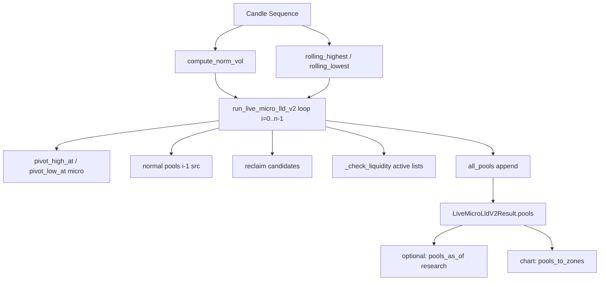

# Forensic Review — Live Micro LLD V2 (READ-ONLY)

**Scope:** `trading_research_platform/indicators/live_micro_lld_v2/` + Research-Adapter `spread_recovery_hedge_short_dev/dashboard/research_charts/chart_live_micro_lld_v2.py`, `service.py` (Candle-Pfad). **Keine Codeänderungen.**

---

## Executive Summary

Die V2-Engine ist ein **einmaliger, indexbasierter Batch-Lauf** über eine `Sequence[Candle]` (`run_live_micro_lld_v2`). Es gibt **keinen** persistierbaren Engine-State, **kein** inkrementelles `update(bar)` und **kein** Checkpoint-API im Paket. Historische Kausalität für **Erzeugung** (`known_at`), **Stärke/Bounds bei Entstehung** und **Liquidity-Break** (`break_at`) ist im Code klar bar-kausal. **As-of-Rekonstruktion** für Scanner/UI erfolgt heute über **`pools_as_of` / `pool_as_of`** (Research-Layer), nicht innerhalb der Engine — mit **Lücken** bei `box_amount`-Eviction und `invalidated_at`.

**Prefix-Parität** (Prefix-Lauf bis T ≡ langer Lauf + `pools_as_of(T)`) ist für **TUTUSDT 15m PD10** in früheren Sessions empirisch **PASS**; im Repo gibt es **keinen** dedizierten Property-Test über alle Felder/TFs.

---

## 1. Call-Graph der Pool-Berechnung



| Schritt | Datei | Funktion | Input | Arbeit | State | Output |
|--------|--------|----------|-------|--------|-------|--------|
| Entry | `engine.py` | `run_live_micro_lld_v2` (92–442) | `candles`, `LiveMicroLldV2Config` | Ein Durchlauf `for i in range(n)` | `upper_active`, `lower_active`, Kandidaten, `all_pools` | `LiveMicroLldV2Result` |
| Bar-Zeit | `availability.py` | `bar_close` (21–22) | open time, TF string | `open + timedelta(minutes(tf))` | — | Decision-close `datetime` |
| Volumen | `volume_strength.py` | `compute_norm_vol` (84–101) | volumes, lookback, percentile | SMA/10 → Percentile → norm cap 10 | — | `norm_vol[i]` |
| Normal-Extrema | `volume_strength.py` | `rolling_highest/lowest` | highs/lows, `swing_len` | Fenster min/max | — | pro Bar |
| Micro-Pivot | `engine.py` | `pivot_high_at` / `pivot_low_at` (30–63) | highs/lows, left/right, `i` | Pivot an Index `p = i - right` | — | Preis oder `None` |
| Active-Cap | `engine.py` | `_enforce_box_amount` (80–84) | `active`, `box_amount` | Älteste aus `active` pop, `active=False`, `invalidated_at` | mutiert `LiquidityPoolV2` | — |
| Break | `engine.py` | `_check_liquidity` (445–466) | `active`, bar i OHLC | strikt `high > top` / `low < bottom` | `break_at`, `active=False`, aus `active` | — |
| As-of (nicht Engine) | `as_of.py` | `pools_as_of` / `pool_as_of` (33–64) | Pool-Dicts, `as_of_close` | filter/mask `break_at`, `active` | — | Snapshot-Liste |

**Öffentliche API des Pakets:** nur `run_live_micro_lld_v2` (`__init__.py`).

---

## 1.1 Exakte Pool-Entstehung (nur Originalcode)

### Candle-Daten

- Engine liest `symbol`, `timeframe`, OHLCV, `timestamp` aus `Candle` (`engine.py` 100–106).
- **Keine** TF-Validierung in der Engine; TF steckt in `timeframe` und `bar_close(..., timeframe)`.

### Volumen → Strength

1. `math_avg_volume` — SMA über **10** Volumes, dann `/10` (`volume_strength.py` 22–43).
2. `percentile_nearest_rank` über **`volume_lookback`** (PD10: **300**) (`46–81`).
3. `norm_vol[i] = vol/ref * 5`, cap **10** (`84–101`).
4. Normal/Reclaim: Gate `>= min_strength` (PD10: **0.0**); Micro optional `micro_strength_filter`.

### Swing / Pivot (Micro)

- `pivot_high_at(highs, micro_left_bars, early_timing, i)` — Pivot-Index `p = i - right` (`30–45`).
- Bestätigung: Pivot wird an Bar **`i`** erkannt (nicht an Pivot-Bar `p`).
- Zonen: `pivot_range * zone_size_mult` (Micro upper: top über Pivot, lower an Pivot).

### Normal Pools

- Bar **`i`**, Quelle **`candles[i-1]`** (`288–358`).
- Upper: `normal_highest[i-1] == src.high` und `high < normal_highest[i]` (und symmetrisch lower).
- Bounds: `src.high ± candle_size(src, zone_size_mult)`.
- Strength: **`previous_strength`** = `norm_vol[i-1]` (nur wenn `previous_valid`).

### Reclaim

- Signal auf Bar `i`; Pool zunächst **`active=False`** (`396–397`, `423`).
- Kandidaten: confirm / expire / broken (`251–286`); bei Confirm → `confirmed_at`, `active=True`, in `upper_active`/`lower_active`.

### `known_at`

| Typ | `known_at` im Code |
|-----|-------------------|
| Micro | `dc = bar_close(ts, timeframe)` an Bar **`i`** (167, 202) |
| Reclaim (create) | `known_at=dc` an Bar **`i`** (391, 418) |
| Normal | `known = bar_close(ts, timeframe)` an Bar **`i`** (297, 326, 350) |

**Pivot-Kerze** = `source_timestamp` / `pivot_timestamp` (oft **vor** `created_timestamp`).
**Erste erlaubte Sichtbarkeit** im Research-Adapter: `start_timestamp = max(from_unix, known_unix)` (`chart_live_micro_lld_v2.py` 65–70).
**Scanner-Verwendung:** **NOT_VERIFIED** (kein Scanner-Consumer von V2 im Repo gefunden).

### `pool_id`

```14:21:trading_research_platform/indicators/live_micro_lld_v2/models.py
def make_pool_id_v2(
    symbol: str,
    timeframe: str,
    pool_type: PoolType,
    side: PoolSide,
    anchor_unix: int,
) -> str:
    return f"lldv2:{symbol}:{timeframe}:{pool_type}:{side}:{int(anchor_unix)}"
```

- Normal: `anchor_unix = int(src_ts.timestamp())` (`317–318`).
- Micro: Pivot-open (`159–160`).
- Reclaim: **Bar-i-open** (`384`, `411`) — nicht Reclaim-Level-Zeit.

### Zusammenführung / nachträgliche Bounds

- **Kein** Merge von Pools; Reclaim-Dedup über `duplicate_pct` / `candidate_max_bars` (`360–377`).
- **top_price / bottom_price / strength / strength_class** werden nur bei **Erstellung** gesetzt — **kein** späteres Update im Loop.

### `zone_extension` (PD-Preset)

- In `config.py` / `presets.py` vorhanden, in **`engine.py` nicht referenziert** → für Laufzeitverhalten **NOT_USED** (nur Preset-Metadaten).

---

## 2. Pool-Lifecycle & Feld-Matrix

| Feld | A | B | C | D | Anmerkung |
|------|---|---|---|---|-----------|
| `pool_id` | ✓ | | | | Anchor bei Create fix |
| `pool_type`, `side`, `symbol`, `timeframe` | ✓ | | | | |
| `source_timestamp`, `pivot_timestamp` | ✓ | | | | Pivot nur Micro |
| `created_timestamp`, `created_index` | ✓ | | | | Bar der Erzeugungslogik |
| `known_at` | ✓ | | | | Bar-close der Entstehungsbar |
| `top_price`, `bottom_price` | ✓ | | | | |
| `strength`, `strength_class` | ✓ | | | | `strength_class` derived aus `strength` bei Create |
| `active` | | ✓ | | | Break, Reclaim, Box-Eviction, Confirm |
| `break_at` | | ✓ | | | Nur `_check_liquidity` |
| `invalidated_at` | | ✓ | | | Box-Eviction / Reclaim fail; **nicht** in `to_dict()` |
| `confirmed_at`, `reclaim_level`, `candidate_created_at`, `early_timing` | ✓/✓ | ✓ | | | Typabhängig |
| `metadata` | | ✓ | | | Default leer |

**Nach Entstehung:** Liquidity-**Break** ändert **`break_at`/`active`**, löscht **nicht** aus `all_pools` (`433–435`, `460–465`). **Box_amount** entfernt nur aus **active-Listen**, Pool bleibt in `all_pools` (`80–88`, `176–177`).

### Zentrale Rekonstruktionsfrage

- **Batch bis T** (nur Kerzen ≤ T): liefert konsistente **Create-Felder** und **break_at** (kausal), sofern Warmup reicht — **teilweise durch Tests** (`test_known_causal_normal`, `test_break_strict_inequality`).
- **`pool_as_of(T)`** auf **vollem** Lauf: maskiert zukünftige `known_at` und **zukünftige** Breaks (`as_of.py` 33–52); setzt bei `break_at is None` **`active=True`** (`49–51`) — **modelliert `box_amount`-Eviction nicht**. → **`active` as-of kann von Engine-`active` abweichen**, wenn Pool nur evicted, nicht gebrochen.
- **Vollständige bitweise Identität** historischer Engine-interner Listen (`active`, Kandidaten): **ohne Checkpoint nicht möglich** — **NOT_VERIFIED**.

---

## 3. Multi-Timeframe

| TF | Engine | Research `SUPPORTED_TIMEFRAMES` | Candle-Quelle (Research) |
|----|--------|----------------------------------|---------------------------|
| 1m | TF-agnostisch (Candle.timeframe) | YES (`boundary.py` 84) | Native 1m CH (`service.py` 559–566) |
| 5m–4h | gleich | YES | 1m → `trp["aggregate"](..., strict_complete_buckets=True)` (`593–597`) |

- **PD10:** identische Preset-Zahlen pro TF (`presets.py` 28 — `swing_len=2`, `volume_lookback=300`, …); **Bar-Anzahl** ist TF-abhängig, **Kalender-Warmup nicht**.
- **Pool-IDs:** TF im String (`:15m:` etc.) — **unabhängig pro TF** (`test_per_tf_ids`).
- **TF-übergreifend:** **keine** Kopplung in `engine.py`.
- **Closed bar:** `filter_candles_closed_at_or_before` + `bar_close` (`as_of.py` 67–77`).
- **Gaps / forming:** Engine prüft **keine** Lücken; forming wird im Research-Pfad vor Engine gefiltert (`chart_live_micro_lld_v2.py` 145–147). Gap-Auswirkung auf Pools: **NOT_VERIFIED**.

**Native vs 1m-Aggregation:** Engine sieht nur gelieferte Candles; Research baut HTF aus **1m** — Parität „native HTF vs aggregiert“: **NOT_VERIFIED**.

---

## 4. Warmup & historische Vollständigkeit

### A. Rechen-Warmup (Bars)

**Research-Adapter (nicht Engine):**

```136:139:spread_recovery_hedge_short_dev/dashboard/research_charts/chart_live_micro_lld_v2.py
    warmup_bars = int(cfg.volume_lookback) + int(cfg.swing_len) + 64
```

**PD10:** `300 + 2 + 64 = **366**` Bars — unabhängig verifiziert (gleiche Formel).

**Engine-intern (untere Schranke):** erstes gültiges `norm_vol` braucht ~**10 + volume_lookback − 1** Bars (`volume_strength.py`); `rolling_highest` braucht **`swing_len`** Bars (`116–117`). **366** ist konservative Research-Padding-Schicht, **nicht** im Engine-Repo als Konstante definiert.

| TF | 366 Bars ≈ Kalender |
|----|---------------------|
| 1m | ~6,1 h |
| 5m | ~1,27 d |
| 15m | ~3,81 d |
| 30m | ~7,6 d |
| 1h | ~15,25 d |
| 4h | ~61 d |

### B. Historischer Pool-Horizont

- `all_pools` **akkumuliert** alle jemals erzeugten Pools (**kein** Pruning der Liste, `120`, `333–334`, …).
- **`box_amount` (default 300)** begrenzt nur **active**-Listen für Break-Tracking (`80–88`) — **nicht** die Rückgabe `result.pools`.
- Endliche Mindesthistorie garantiert **nicht** „alle jemals relevanten“ Pools ohne ausreichend lange Candle-History; ältere Pools bleiben in `all_pools`, wenn sie im Lauf erzeugt wurden.

### C / D. Initial-Build & Live

- Heute: **jeder** Aufruf = voller Batch über geladene Candles — **kein** Live-Fortschreibungs-API.
- Fortschreibung nur durch **externes** Wiederholen mit erweitertem Candle-Slice — **NOT_VERIFIED** äquivalent zu einem hypothetischen inkrementellen State ohne dedizierten Test.

---

## 5. Prefix-Safety & Kausalität

| Frage | Code-Beleg | Status |
|-------|------------|--------|
| Pools vor `known_at` sichtbar? | Adapter `start = max(from_unix, known_unix)` | Nein in API-Zonen |
| Pivot-Backfill? | Create nur bei Bar `i`, `known_at` = Close von `i` | Nein (Create) |
| Strength mit Zukunft? | Nur Indizes ≤ `i` / `i-1` / `i-et` | Nein bei Create |
| Späterer Break ändert `known_at`/Bounds/Strength? | Nur `break_at`, `active` | Nein für Immutable-Felder |
| Prefix ≡ lang + as_of? | Kein Unit-Test; TUTUSDT 15m empirisch PASS | **Teilweise bestätigt** |
| Gilt für alle Felder? | `pools_as_of` ändert nur `break_at`/`active`; Chart-Segmente nutzen `break_at` für `end` | **Segmente ja; `active`/Eviction lückenhaft** |

Tests: `test_known_causal_normal` (200–209), `test_as_of.py`, `test_break_strict_inequality` (155–197).

---

## 6. Inkrementelle Fortschreibung

**ENGINE_SUPPORTS_INCREMENTAL_UPDATES = NO**

- Kein State-Dataclass, kein `step(candle)`, kein Resume-Hook im Paket.
- In-Memory-State pro Lauf: `norm_vol` (vorberechnet), `upper_active`/`lower_active`, Reclaim-Kandidaten, Reclaim-Dedup-Tracker (`122–125`), `all_pools`.

Für spätere Inkrementalisierung müssten mindestens persistiert werden (aus Code abgeleitet, **Design only**): aktive Listen + Kandidaten, Reclaim-Last-Level/Bar, komplette oder fensterierte Volume-History für `norm_vol`, Rolling-Extrema-Fenster — **Äquivalenz zur Batch-Engine: NOT_VERIFIED**.

---

## 7. Checkpoint / Resume

**ENGINE_STATE_SERIALIZABLE = NO** (kein serialisierbares Objekt)
**EXACT_RESUME_POSSIBLE = NOT_VERIFIED** (ohne neuen State-Layer)

`LiquidityPoolV2.to_dict()` exportiert **nicht** `invalidated_at`, `created_index` (`49–72` in `models.py`) → unvollständig für bitgenaue Wiederherstellung.

---

## 8. Event-Sourcing-Eignung

| Übergang | Im Code eindeutig? | Kausaler Zeitpunkt |
|----------|-------------------|-------------------|
| Pool Created | Ja (`all_pools.append`) | `known_at` |
| Liquidity Broken | Ja | `break_at` = `bar_close` Break-Bar |
| Reclaim confirmed / expired / broken | Ja | `confirmed_at` / `invalidated_at` |
| Box eviction | Ja intern | `invalidated_at` (≠ `break_at`) |
| Strength/Bounds changed | **Nein** nach Create | — |

**POOL_EVENTS_LOSSLESS = NO** (Eviction + fehlende Felder in `to_dict`)
**EVENT_PLUS_CHECKPOINT_RECONSTRUCTION = NOT_VERIFIED**
Für **Scanner-parität** auf **`pools_as_of` + kanonische Pool-Dicts** reichen Events **nur**, wenn Checkpoint **Engine-internen** State + `all_pools` oder **vollständige Snapshots pro Decision-Close** enthalten.

---

## 9. ClickHouse-Modelle (konzeptionell, read-only)

**Vorhanden:** `ClickHouseResearchCandleSource` — read-only `candles_1m`, `is_closed=1` (`clickhouse_source.py` 1–6, 38–48). HTF via TRP-Aggregation (`service.py`).

| Kriterium | A Snapshots | B Events+CP | C Hybrid |
|-----------|-------------|-------------|----------|
| Historische Rekonstruktion | Stark | Stark wenn CP vollständig | Stark |
| Live-Fortschreibung | Teuer (voller Re-run) | Mittel | Mittel |
| GO-TO / Scroll | Schnell lesen | Replay-Kosten | Schnell mit Materialized as-of |
| Scanner/UI-Parität | Einfach (ein Blob/Hash) | Braucht disziplinierte Versionierung | **Am besten** |
| Volumen | Hoch | Mittel | Konfigurierbar |
| Debugging | Einfach | Gut | Gut |

**Keine Tabellen erstellt** — Wiederverwendung nur **1m SoT** + berechnete V2-Artefakte.

---

## 10–12. Scanner/UI-Parität, Multi-TF, Cutover (konzeptionell)

**Zwingend für 1:1:**

- Eine **autoritative** Berechnung: `run_live_micro_lld_v2` + feste `LiveMicroLldV2Config` (PD, flags).
- **Decision-close** pro TF (keine forming bar) — wie Research bereits filtert.
- **State-ID** = Hash aus `(symbol, tf, decision_close_iso, engine_git_version, config_hash, candle_source_revision)`.
- **Veröffentlichung** nur wenn Candles für `[load_start, decision_close]` vollständig (Warmup + Continuity-Checks).
- **Leer vs fehlend:** explizites Flag `data_complete` / `pool_state_status`.

**Multi-TF-State-Vektor:** Pro Scanner-Decision `T_scan` je TF `decision_close_tf = last_closed(tf, T_scan)` und **veröffentlichter** Pool-State zu genau diesem Close — **keine** Vermischung unterschiedlicher Versionsstände.

**Cutover:** Historischer Batch bis `last_closed` aller TFs → Snapshots/Events → Live = neuer Close triggert neuen Batch oder (später) inkrementell **nur nach Nachweis**.

---

## 13. Architektur-Empfehlung (aus Engine-Eigenschaften)

Die Engine ist **batch-deterministisch auf fixen Inputs**, **nicht increment-ready**. Kleinste Änderung an der **Logik**: **keine** — nur **Persistenz + Reader**.

**Empfohlen: Modell C (Hybrid)**

1. **Kanonischer Snapshot** pro `(symbol, tf, decision_close, config_version)` = vollständige `LiquidityPoolV2.to_dict()`-Erweiterung inkl. `invalidated_at` + `pools_as_of` optional **nicht** nötig, wenn Snapshot **already as-of** at `decision_close` erzeugt wird (Batch nur bis Close).
2. **Optionale Events** für Auditing (Created, Broken, Reclaim-Übergänge) — aus Replay des Snapshots oder Hook im Runner, **nicht** Engine ändern.
3. **Checkpoints** nur wenn später inkrementell — sonst Snapshot pro Close genügt für Scanner/UI-Parität.

**Weniger geeignet:** reines Event-Sourcing **ohne** vollständige Checkpoints (Eviction-Lücke). **Nur** Live-Re-Compute für Scanner (Paritäts- und Last-Risiko).

---

## 14. Abschlussbericht (Felder)

### A. Originale Engine

```
ORIGINAL_ENGINE_ENTRYPOINT = trading_research_platform/indicators/live_micro_lld_v2/engine.py :: run_live_micro_lld_v2 (L92)

POOL_CREATION_LOGIC = pro Bar i: micro (pivot+et), normal (src i-1), reclaim (Kandidat); append all_pools; active lists + box_amount

POOL_ID_SEMANTICS = lldv2:{symbol}:{tf}:{type}:{side}:{anchor_unix} (models.py L14-21)

KNOWN_AT_SEMANTICS = bar_close(open der Entstehungs-/Bestätigungsbar i, timeframe) (availability.py L21-22)

BREAK_AT_SEMANTICS = bar_close bei striktem Durchbruch high>top / low<bottom (_check_liquidity L445-466)

STRENGTH_UPDATE_LOGIC = nur bei Create aus norm_vol an i / i-1 / i-et; danach immutable

BOUNDS_MUTABILITY = immutable nach Create (kein Update im engine loop)

POOL_LIFECYCLE = create → (optional reclaim confirm) → active list → break OR box eviction OR reclaim invalidation; all_pools behält Historie
```

### B. Timeframes

```
TF_SUPPORT_1M = YES (boundary + service native 1m)
TF_SUPPORT_5M = YES
TF_SUPPORT_15M = YES
TF_SUPPORT_30M = YES
TF_SUPPORT_1H = YES
TF_SUPPORT_4H = YES
TF_INDEPENDENCE = YES (keine cross-TF in engine; IDs enthalten tf)

CANDLE_SOURCE_PER_TF = 1m native CH; HTF via 1m aggregate strict (service.py L559-597)

TF_PARAMETER_MATRIX = pool_detail presets TF-unabhängig (presets.py); wall-clock warmup scales with bar duration
```

### C. Historie

```
WARMUP_REQUIREMENTS_PER_TF = Research: volume_lookback + swing_len + 64 bars (chart_live_micro_lld_v2.py L136-139); PD10 => 366 bars

HISTORICAL_POOL_HORIZON = all_pools unbounded in single run; active tracking capped by box_amount=300 default

PREFIX_CAUSALITY = PASS (code+tests partial); full multi-field multi-TF: NOT_VERIFIED

HISTORICAL_ASOF_PARITY = PASS (pools_as_of tests + TUTUSDT 15m empirical); active+eviction: CONDITIONAL
```

### D. Persistenz

```
ENGINE_SUPPORTS_INCREMENTAL_UPDATES = NO

ENGINE_STATE_SERIALIZABLE = NO

EXACT_RESUME_POSSIBLE = NOT_VERIFIED

POOL_EVENTS_LOSSLESS = NO

EVENT_PLUS_CHECKPOINT_RECONSTRUCTION = NOT_VERIFIED

FULL_SNAPSHOTS_REQUIRED = CONDITIONAL (minimal path for 1:1 without engine change: YES per decision-close snapshot)
```

### E. Architektur

```
RECOMMENDED_PERSISTENCE_MODEL = Hybrid C (decision-close snapshots + metadata + optional audit events)

RECOMMENDED_CANONICAL_STATE_MODEL = Batch engine output at decision_close (complete candle window), content-addressed hash

RECOMMENDED_MULTI_TF_DESIGN = Independent published state per TF aligned to last_closed(tf, T_scan)

RECOMMENDED_SCANNER_UI_READER = Single read-only service: fetch snapshot by state_id; scanner filters downstream only

LIVE_CUTOVER_REQUIREMENTS = Warmup-complete candles; publish gate; version pins; no partial publishes

OPEN_TECHNICAL_RISKS = (1) box_amount vs pools_as_of active semantics (2) HTF agg vs native (3) prefix tests missing per TF (4) to_dict incomplete (5) deep GO TO narrow from_close in UI

SAFE_TO_BEGIN_IMPLEMENTATION = YES (persistenz/reader design + proofs); NO for production scanner on V2 without per-TF parity suite
```

### F. Konkrete Empfehlung

1. **Beste Architektur:** **Decision-close Snapshots** der **rohen** `run_live_micro_lld_v2`-Outputs (erweitertes Schema), plus **State-ID/Hash** und **data_complete** — Scanner und UI lesen **identischen** Snapshot.
2. **Weniger geeignet:** reine Events ohne Engine-State; Scanner-eigene V2-Nachberechnung; `pools_as_of` allein als kanonisch ohne Klärung Eviction.
3. **Risiken (priorisiert):** (P0) 1:1-Nachweis pro TF/Symbol; (P1) `active`/`invalidated_at` Semantik; (P2) Candle-Revision/Backfill-Policy; (P3) CH-Volumen.
4. **Minimaler Plan:** (1) Snapshot-Schema + Hash (2) Offline-Runner `chart_live_micro_lld_v2`-äquivalent batch (3) Property-Tests Prefix≡As-of alle TFs (4) Reader-API (5) UI/Scanner auf Reader (6) optional Inkrementell **nach** formaler Äquivalenz.
5. **Nachweise vor produktivem V2-Scanner:** Prefix-Parität **alle 6 TFs** × Stichproben-Symbole; Warmup-Grenztests; `known_at`/Break-Tests erweitert auf Reclaim/Micro; veröffentlichter **empty vs incomplete**; Backfill-Drill.

---

**Absolute Priorität bestätigt:** Die Forensik zeigt, dass die **originale** `run_live_micro_lld_v2`-Logik der einzige legitime Pool-Erzeuger bleiben sollte; Persistenz muss deren Outputs **versioniert und unverändert** bereitstellen — nicht ersetzen oder „ähnlich“ nachbauen.

[REDACTED]