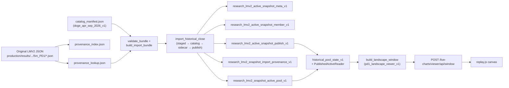

# PHASE 6XT — 5M PD1 RESEARCH CHART READINESS V1

**VERDICT:** `5M_PD1_PIPELINE_CHANGES_REQUIRED`

**Read-only.** No ClickHouse writes, no viewer switch, no catalog file changes in this phase.

Artifacts:

`logs/historical_import/overnight_2026/phase6xt_5m_pd1_research_chart_readiness_v1/`

- `dry_run_validate_all.json` (2592-close import simulation)
- (CH baseline captured inline below; same queries as controlled import)

Prior:

- `reports/PHASE_6XT_5M_PD1_STRICT_REFERENCE_CONTROLLED_IMPORT_V1.md` — `5M_PD1_CONTROLLED_IMPORT_PASS`
- `reports/PHASE_6XT_5M_PD1_STRICT_REFERENCE_PILOT_PLAN_V1.md`

---

## 1. Executive summary

| Layer | Status |
|-------|--------|
| **Catalog files** (2592 × `5m_PD1` Sep window) | **Ready** — on disk + provenance index |
| **Import dry-run** (`build_import_bundle` + `validate_bundle` + write plans) | **2592/2592 PASS**, 0 errors |
| **ClickHouse publish** (`…_5mpd1_v1`) | **0 rows** — import not executed |
| **Research chart binding** | **Not ready** — backend + viewer still hard-wired to **15m** PD1 line and **15m** causal decision grid on a **5m** price timeline |
| **168h / ACTIVE origins** (file-level) | **OK** for pilot window — not `5M_PD1_HISTORY_CONTEXT_BLOCKED` |

**Sub-readiness:** ClickHouse batch import is **mechanically ready** after a **small config parity** fix (`ISOLATED_IMPORT_COMBOS` in the pools repo importer). That alone does **not** attach 5m PD1 pools to the chart.

---

## 2. Data flow (existing architecture)

**Today:** Steps through **catalog files** for 5m PD1 are done. Steps **IMP → PUB** for line `historical_mixed_frozen_doge_apr_sep_2026_v1_5mpd1_v1` are **empty**. Steps **SSOT → JS** resolve **15m** PD1 only.

---

## 3. ClickHouse tables and publish lines

| Table | Role |
|-------|------|
| `research_lmv2_active_snapshot_meta_v1` | Per-close meta (timeframe, `config_hash`, fingerprints) |
| `research_lmv2_active_snapshot_member_v1` | ACTIVE membership index |
| `research_lmv2_snapshot_active_pool_v1` | Pool bounds / strength / `known_at` catalog |
| `research_lmv2_snapshot_import_provenance_v1` | Import sidecar (batch path) |
| `research_lmv2_active_snapshot_publish_v1` | Publish ledger (`publish_complete`, `pipeline_line_id`) |

| Line | Combo | Publish count (read 2026-10-21) |
|------|-------|--------------------------------|
| `historical_mixed_frozen_doge_apr_sep_2026_v1_15mpd1_v1` | 15m PD1 | **17568** |
| `historical_mixed_frozen_doge_apr_sep_2026_v1_5mpd1_v1` | 5m PD1 | **0** |

**Required line for 5m PD1:** `StrategyCombo("5m", 1).pipeline_line_id()` → `historical_mixed_frozen_doge_apr_sep_2026_v1_5mpd1_v1`.

**Schema:** Existing tables already store `timeframe` on meta/publish/catalog rows; **no new CH DDL** required for 5m PD1 (verified via `build_write_plan` on 5m payloads: `state.timeframe == "5m"`).

---

## 4. Import readiness

### 4.1 Reusable functions (unchanged order)

From `historical_json_import/` (same as 15m production path):

1. `build_import_bundle` / `validate_bundle`
2. `validate_batch` → `summarize_plans`
3. `assert_productive_env_gates` + `execute_batch_import`
4. `import_historical_close` (staged → catalog → sidecar → publish)
5. `run_batch_readback_gate` (`require_sidecar=True`)

### 4.2 Measured dry-run (all 2592 closes)

`dry_run_validate_all.json`:

| Metric | Value |
|--------|------:|
| `snapshot_count` / `publish_rows` / `meta_rows` / sidecar (planned) | **2592** |
| `member_rows` | **440098** |
| `catalog_rows` | **440098** |
| `validate_bundle` errors | **0** |
| Pools per close (min / max) | **141 / 193** |

**Batch topology:** `DEFAULT_BATCH_SIZE_CLOSES = 50` → **52** batches (last **42** closes), same as 15m orchestration.

### 4.3 Blocker: `combo_for_folder("5m_PD1")` in **this** repo

| Location | `5m_PD1` in `combo_for_folder` |
|----------|----------------------------------|
| `pools+ob+delta_bot/.../historical_batch_config.py` | **No** → `validate_batch` / `execute_batch_import` raise `BatchImportError` |
| `spread_recovery_hedge_short_dev/dashboard/.../historical_batch_config.py` | **Yes** (`ISOLATED_IMPORT_COMBOS`) |

**No new import architecture** — port `ISOLATED_IMPORT_COMBOS` + extended `combo_for_folder` to the dashboard copy that runs the live chart (or run writes only from spread tree with identical code). Pilot plan already flagged this drift.

### 4.4 Idempotency / rollback

- `resolve_existing_publish` + matching catalog → **skip** (no silent overwrite).
- `PublishConflictError` on fingerprint mismatch → **stop batch**.
- Resume: re-run same `BatchSpec` / `import_batch_id`.
- Rollback: delete by `pipeline_line_id` + snapshot_id set (manual; no one-shot cleanup command) — per pilot plan.

### 4.5 Coverage matrix

Unchanged by design (`coverage_matrix.json` SHA stable in controlled import). Importer does **not** call `assert_mixed_coverage` today; **do not** add 5m rows with `MISSING != 0` without a separate matrix strategy.

---

## 5. Causal history validation (file-level, pilot scope)

| Check | Result |
|-------|--------|
| Context files 2026-09-09 … 2026-09-15 | **2016/2016** present |
| Visible tile 2026-09-16 … 2026-09-17 | **576/576** present |
| `WARMUP_HOURS = 168` for tile start 2026-09-16 00:00Z | Context from **2026-09-09 00:00Z** — **matches** imported set |
| Visible start `history_from_close` | **2026-05-16T00:00:00Z** |
| Earliest ACTIVE origin at visible start | **2026-06-02T00:05:00Z** (after `history_from_close`) |
| Frozen input | **`fe549309…`** only |

**Verdict:** **Not** `5M_PD1_HISTORY_CONTEXT_BLOCKED` — 168h preload does not clip pre-window ACTIVE origins for this tile.

**Caveat:** After CH import, the **chart must load 5m publications every 5m**, not 15m snapshots on a 5m grid (see §7).

---

## 6. ACTIVE / Remaining compatibility

| Mechanism | Current behavior |
|-----------|------------------|
| `build_landscape_window` | `include_remaining=False`; ACTIVE only |
| `load_historical_pool_state_at_close` | Supports Remaining when enabled; landscape viewer **off** |
| `historical_pool_state_v1` | **`timeframe` must equal `hcfg.timeframe` (15m)** — rejects 5m |
| `resolve_historical_pd_config` | Always **`HISTORICAL_TIMEFRAME = "15m"`** and `…_15mpd1_v1` |

5m JSON snapshots contain **5m** `pool_id` timestamps and **5m** `decision_close`; they are **not** interchangeable with 15m PD1 CH rows (different close grid and engine_input per close).

---

## 7. Viewer readiness

### 7.1 Backend (`pd1_landscape_viewer_v1`)

| Capability | Finding |
|------------|---------|
| API | `GET …/capabilities`, `POST …/window`, `GET …/membership` |
| Price candles | **5m** from `ClickHouseResearchCandleSource` (not from LMV2 JSON) |
| Pool overlays | From CH via `load_historical_pool_state_at_close` |
| `landscape_capabilities()` | Exposes **`pipeline_line_id` = 15m PD1** only |
| `_causal_15m_decision_close` | Membership stepped on **15m** grid while iterating **5m** timeline |
| Live probe | `build_landscape_window('2026-09-16','2026-09-17')` **succeeds** with **285** pools, **576** prices — using **`…_15mpd1_v1`**, not 5m imports |

### 7.2 Frontend (`replay.js`)

| Item | Finding |
|------|---------|
| Candle grid | **5m** snap (`snapMsTo5mFloor/Ceil`) |
| `causalDecisionCloseMs` | **15-minute** slots (`UTCMinutes / 15`) |
| Timeframe / PD picker | **No** separate 5m historical line toggle in viewer bundle |
| `remaining` | Off in API provenance |
| Prefetch | Dynamic window + edge prefetch; **5-day prefetch not implemented** (out of scope) |

**Conclusion:** Viewer **displays 5m prices with 15m pool state**. That matches today’s **15m PD1** research chart, **not** original **5m PD1** snapshots.

### 7.3 Performance note (read-only)

- **2592** closes × ~170 pools/close → **~440k** catalog rows on import (measured).
- Landscape window loads **membership per 15m DC** over **context + visible** 5m steps (batch reader optional). Full Sep prefetch would be heavier than single 48h tile — requires **measured** benchmarks after 5m line binding (not done here).

---

## 8. 15m baseline (unchanged)

ClickHouse `FINAL`, read 2026-10-21:

| Field | Value |
|-------|--------|
| `…_15mpd1_v1` publish count | **17568** |
| `config_hash` (PD1 preset) | **`4aeb36fe22ef3ab24fc65c8e7bc33b6ca499dd51759d07936c96fee781c641c9`** |
| Ref `2026-09-14T21:45:00Z` `snapshot_id` | `3c6bacc268daa59b24f239fb3ad804cb4dc45a53a1b6a92536055f66d7d0dc4c` |
| Ref `active_state_fingerprint` | `71cc7b3ee8f4f0ea7e802fab08eead62c96d30d6a567f5d4e5365b960e9415a0` |
| Ref `prefix_candle_fingerprint` | `4da21e346a9b4b014bbeb97594611423` |

No 15m publish or catalog mutation in this phase.

---

## 9. Blockers and risks

| ID | Severity | Description |
|----|----------|-------------|
| B1 | **High** | `historical_lmv2_pd_contract_v1` — no `("5m", 1)` → `…_5mpd1_v1` |
| B2 | **High** | `load_historical_pool_state_at_close` — hard fail unless `timeframe == "15m"` |
| B3 | **High** | `build_landscape_window` / batch prefill — `_causal_15m_decision_close` on 5m grid |
| B4 | **High** | `replay.js` — 15m causal DC for density / clusters |
| B5 | **Medium** | `combo_for_folder` missing `5m_PD1` in **pools** repo blocks `validate_batch` wrapper |
| B6 | **Medium** | Importer copy drift vs `spread_recovery_hedge_short_dev` |
| B7 | **Low** | CH import volume ~440k catalog rows — batch + readback runtime |
| B8 | **Low** | Coverage matrix policy if scope expands beyond pilot window |

---

## 10. Smallest safe next step (ordered, each needs freigabe)

1. **Config parity (no CH):** Add `ISOLATED_IMPORT_COMBOS = (StrategyCombo("5m", 1),)` and `combo_for_folder` union in **pools+ob+delta_bot** `historical_batch_config.py` (mirror spread dashboard). Re-run `validate_batch` on one 50-close spec.

2. **ClickHouse import only (separate freigabe):** 52 batches to `…_5mpd1_v1`, `import_batch_id` derived from batch UUID `13d8eb76-…` or new run id; env gates + `run_batch_readback_gate` per batch; **no** viewer changes.

3. **Chart binding (separate freigabe):** Extend `resolve_historical_pd_config(timeframe, pool_detail)` (or parallel resolver), relax `load_historical_pool_state_at_close` for 5m, switch landscape builder + `replay.js` to **5m causal decision close** when line is 5m; gate viewer on `…_5mpd1_v1` `publish_complete` for pilot window only.

4. **5-day prefetch:** Only after (3) and measured load tests.

---

## 11. Verdict rationale

| Candidate | Why not |
|-----------|---------|
| `5M_PD1_CH_IMPORT_READY_FOR_APPROVAL` | True for **CH only**, but task is **research chart** readiness; chart cannot consume 5m imports yet. |
| `5M_PD1_HISTORY_CONTEXT_BLOCKED` | File evidence contradicts. |
| `5M_PD1_READINESS_INCONCLUSIVE` | Pipeline path and gaps are identified with measured dry-run. |

**`5M_PD1_PIPELINE_CHANGES_REQUIRED`** — catalog + provenance are ready; CH import is a known, gated next step; **viewer/SSOT contract** must evolve before 5m PD1 overlays match original snapshots.

**STOP** — no CH import, no viewer switch, no queue changes.
