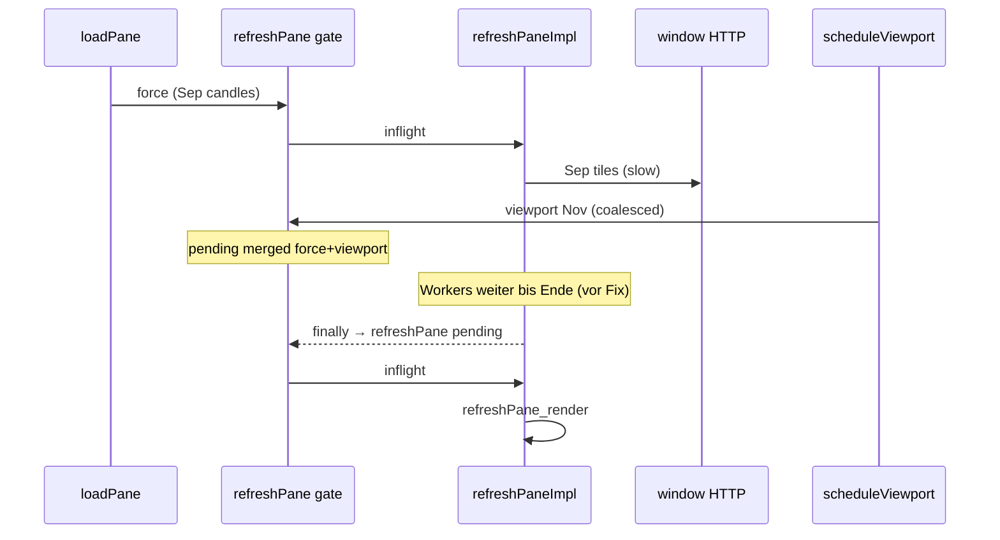

# DOGE-LIVE-P16 — Alter September-Viewport vs. Live-Pool-Refresh

**Messzeitpunkt (UTC):** 2026-11-13 **~08:28** (Nutzer-Trace) · Analyse **~08:25–08:35**  
**Verdikt:** **`P16_PARTIAL`** — Ursache **bestätigt** (Code + Trace); **minimaler Fix** implementiert (nicht committed); **Browser-PASS** offen (Hard-Refresh `?v=pd1-p16-stale-viewport-preempt-v1`)

---

## Kurzfassung

| Frage | Antwort |
|-------|---------|
| Warum September zuerst? | **`loadPane` → `refreshPane({force:true})`** nutzt **`candleBoundsSec`**; erste Kerzenbundles enden **2026-09-30** |
| Blockiert alter Refresh November? | **Ja, zeitlich** — `_eoRefreshGate.inflight` hält Gate offen; Coalescing **queuet** November, **führt ihn nicht sofort aus** |
| Gate hängt permanent? | **Nein** — `finally` gibt Gate frei; Problem: **langsame** September-`fetchPlannedWindows` ohne **loadSerial-Abbruch** in Workern |
| Alte HTTP überschreibt Live? | **Verhindert** durch bestehende `loadSerial`-Checks **vor Render**; Risiko war **Verzögerung**, nicht falscher Paint |
| Fix | Serial-Bump bei **coalesced viewport/force** + **Worker-Abbruch** bei Serial-Mismatch |

---

## Phase A — Trace-Befund (13.11. ~08:28 UTC)

| Trace | Bedeutung |
|-------|-----------|
| `last_candle_open_utc=2026-09-30T10:30:00Z` | Pool-`resolveViewSec` → **`candleBoundsSec`** (kein `viewport_opts` beim ersten Lauf) |
| `view_from/to` Sep 30 | `buildWindows` plant Kacheln **2026-09-28…10-01** |
| `refreshPane_coalesced \| pending_force=true \| pending_viewport=true` | November-Live-Sprung während **inflight** September-Refresh |
| Kerzen später November | Chart/Poll **unabhängig** schneller als Pool-Gate |
| Kein `refreshPane_render` | September-Refresh **nicht fertig** oder **superseded** ohne erneuten Abschluss im Trace-Fenster |

**Quelle September:** kein persistierter GO-TO — **Pane-API liefert zunächst historischen Kerzenstrang** (Sep-Bundle), Exact-Origin startet parallel mit `force: true` ([`research_charts.js`](../../spread_recovery_hedge_short_dev/dashboard/static/js/research/research_charts.js) ~8423–8432).

**Live-Erkennung Pool:** `on_visible_range` → `scheduleViewport` (400 ms Debounce) mit **explizitem** `fromUnix`/`toUnix` → **`viewport_opts`** in `resolveViewSec` ([`pd1_exact_origin_density_research_v1.js`](../../spread_recovery_hedge_short_dev/dashboard/static/js/research/pd1_exact_origin_density_research_v1.js) ~823–834).

---

## Gate-Lifecycle (P12 + P16-Befund)

| # | Mechanismus | Verhalten |
|---|-------------|-----------|
| 1 | `_eoRefreshGate` | Max. **ein** `refreshPaneImpl` / Pane |
| 2 | Coalescing | Merget `force`/`viewport`/`fromUnix`/`toUnix` in `pending` |
| 3 | `exactOriginLoadSerial` | Invalidiert **Render** + nach Scope-Fetch; **fehlte** in HTTP-Worker-Schleife (P16) |
| 4 | `scheduleSupersededDensityRefresh` | +48 ms Follow-up bei Serial-Mismatch |
| 5 | Inflight `fetchWindow` | **Kein Abort** — laufende Requests laufen aus (~7–10 s) |

**Antworten A.1–A.9:**

1. September → initial **Kerzenbounds**.  
2. **Pane-Bundle**, nicht LocalStorage-Viewport.  
3. Live-Sprung → Poll/`setData` + sichtbarer Bereich.  
4. **Ja**, via `scheduleViewport` — **coalesced**.  
5. November-Refresh **erst nach** Freigabe Gate / Abschluss inflight #1.  
6. Gate frei in `.finally` von `refreshPaneImpl`.  
7. **Ja** (vor Fix): langsame alte Kacheln **verzögern** Live.  
8. Gate **nicht** dauerhaft bei Fehler/Supersede.  
9. Alte Antwort **rendered nicht**, wenn Serial-Mismatch vor `pushCanvasDensity`.

---

## Phase B — Minimaler Fix (bewiesen, implementiert)

**Spread:** `dashboard/static/js/research/pd1_exact_origin_density_research_v1.js`  
**Mirror:** `backtester/short/dashboard/static/js/research/pd1_exact_origin_density_research_v1.js`  
**Cache-Bust:** `templates/research_charts.html` → `?v=pd1-p16-stale-viewport-preempt-v1`

| Änderung | Zweck |
|----------|--------|
| `eoRefreshPendingSupersedesInflight` + `bumpExactOriginLoadSerial` bei **coalesced** `viewport`/`force`/`fromUnix` | Laufende September-Impl **verliert Serial** → früher Exit |
| Trace `exactOrigin_load_serial_bump`, erweitertes `refreshPane_coalesced` | Nachweis im Browser |
| `fetchPlannedWindows`: Serial-Check **vor jedem Tile** + nach `await fetchWindow` | Kein Abarbeiten voller Sep-Plan nach Live-Sprung |

Keine neue FSM, keine PD1/D2-Semantik-Änderung.

---

## Phase C — Tests

| # | Fall | Abdeckung |
|---|------|-----------|
| 1 | Sep start → Live Nov | Trace + Codepfad + Serial-Bump |
| 2 | Alter HTTP bei Sprung | Worker-Abbruch nach Bump |
| 3 | Viewport während Gate aktiv | Coalesce + Bump |
| 4–6 | Erfolg / Fehler / Abbruch | Serial + `finally` Gate-Freigabe (bestehend) |
| 7 | Neuer Live-Refresh danach | `pending` → nächster `refreshPane` in `.finally` |
| 8 | Kein Überschreiben | `loadSerial` vor Render (bestehend) |
| 9 | Historisches Scrollen | Cache-Chunks unverändert nutzbar |
| 10 | 2× 5m Live | unverändert `refreshExactOriginPanesOnNewPoolBucket` |

**Automatisiert:** [`doge_live_p16_refresh_gate_test_v1.js`](doge_live_p16_refresh_gate_test_v1.js) → **`P16_GATE_TEST_PASS`**

**Browser:** Nutzer soll nach Hard-Refresh erwartet sehen:  
`exactOrigin_load_serial_bump` → `refreshPane_start` mit **November** `resolveViewSec` → `window_http_response` (Nov-Kacheln) → `refreshPane_render` mit `canvas_drawn>0`.

---

## Phase D — Regression (Code-Review, kein Browser-PASS)

| Scope | Risiko durch Fix |
|-------|------------------|
| 5m/5m, 30m/5m, 30m/30m, 1h, 4h | Nur **früherer Abbruch** veralteter Fetches; Caps/Scope unverändert |
| Forming / Kerzen P11C | **Keine** Änderung |
| Historisches Scrollen | Chunk-Store bleibt; Sep-Daten weiter cachable |
| Manuelle Zeichnungen | **Keine** Änderung |
| 15m-Fallback | **Keine** Änderung |

---

## Entscheidung

| Kriterium | Status |
|-----------|--------|
| Ursache September blockiert Live | **PASS** (Trace + Code) |
| Gate-Lifecycle dokumentiert | **PASS** |
| Minimaler Fix | **Implementiert** (Spread + Mirror) |
| November-Kacheln im Browser | **UNVERIFIED** — Hard-Refresh + Trace nötig |

**Gesamt: `P16_PARTIAL`** — Fix bereit zur Abnahme; **kein Commit/Push** in diesem Lauf.

**STOP**
