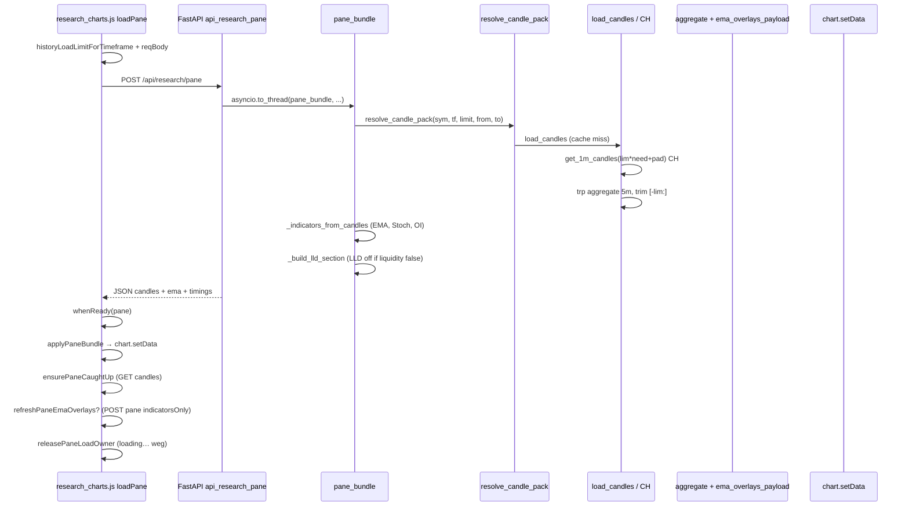

# MC-LOAD-P2 Root Cause (READ-ONLY)

**Quelle:** Browser-JSON-Trace 26.11.2026 (BNBUSDT 5m, Single View, Layers laut Trace aus)  
**Code-Basis:** `spread_recovery_hedge_short_dev/dashboard/` (Stand Audit)  
**Status:** Analyse only — **keine** Optimierung implementiert.

---

## Kurzfassung

| Beobachtung (Trace) | Einordnung |
|---------------------|------------|
| Initial **66.804** Kerzen, Pane POST **~22 ms** (Server) | **USER_TRACE** — Limit-Rechner Client + volles Historien-Fenster ohne `from`/`to` |
| **ema-post-catch-up** **50.000** Kerzen, **~13 ms** (Server) | **CODE_PATH** — `paneEmaStaleVsCandles` → zweiter `loadPane(..., indicatorsOnly)` mit `limit: min(50000, …)` |
| Gap-Backfill **3.000** Kerzen | **CODE_PATH** — `ensurePaneCaughtUp` bei Tip-Lag |
| `setData` **~474 ms** (manuell/Long-Task) vs. Trace `chart_setdata_*` **~26 ms** | **INSTRUMENTATION_GAP** — Events umschließen Call, erfassen aber nicht Innenlaufzeit LWC; 474 ms plausibel bei ~67k Punkten |
| First render proxy **39.595 s** (`t_rel_ms` **39595**) | **USER_TRACE** — Doppel-RAF nach `setData`; **Sekunden**, nicht ms |
| Loading hidden **42.478 s** (`t_rel_ms` **42478**) | **USER_TRACE** — nach Catch-up + EMA-Reload, vor Owner-Ende |
| **P2-Fehler (korrigiert)** | `frontend_timings_ms` nutzt **`t_rel_ms` seit Trace-Start** → 42478 = **~42,5 s**, nicht ~42 ms |
| Langsame Pool-/Lease-Requests | **Separate** Befunde (vgl. P1B), zusätzlich zur Pane-Kette |

---

## 1. Kanonische Kette: `/api/research/pane` → Browser



| Stufe | Modul | Funktion / Datei |
|-------|--------|------------------|
| Client Request | `research_charts.js` | `loadPane` → `sendJson("/api/research/pane", …)` |
| HTTP | `research_charts/api.py` | `api_research_pane` → `pane_bundle` |
| Candle SoT | `research_charts/service.py` | `resolve_candle_pack` → `load_candles` |
| ClickHouse | `clickhouse_source.py` | `get_1m_candles` (1m rows, `newest_first_limit` wenn kein start) |
| Aggregation | TRP via `service.py` | `trp["aggregate"](source_1m, "5m", strict_complete_buckets=True)` |
| Serialisierung | `service.py` | `candles_to_payload` → JSON-Array |
| Indikatoren | `service.py` | `_indicators_from_candles` → `trp["ema_overlays_payload"](candles, ema_cfg)` |
| Parse | `research_charts.js` | `sendJson` → `res.json()` |
| Chart | `research_trp/chart.js` | `setData` → `rebuildIndex`, `applySeriesData`, `applyDefaultView` (~120 sichtbare Bars) |

**Diag-Serverfeld:** Header `X-MC-Load-Diag: 1` → `payload._diag.pane_bundle_wall_ms` (gesamt inkl. EMA/LLD im Thread).

---

## 2. Warum ~66.804 Kerzen beim Initial-Load?

### Limit-Berechnung (Client)

```793:798:spread_recovery_hedge_short_dev/dashboard/static/js/research/research_charts.js
  function historyLoadLimitForTimeframe(tf) {
    const uiWeeks = $("lldHistoryWeeks") ? Number(($("lldHistoryWeeks") || {}).value || 0) : 0;
    const weeks = Math.max(1, Number(uiWeeks || (state.history && state.history.weeks) || 12) || 12);
    const step = TF_SEC[tf] || 60;
    return Math.max(100, Math.round((weeks * 7 * 24 * 3600) / step));
  }
```

Für **5m** (`step = 300`): `limit ≈ weeks × 2016`.  
**66.804 ≈ 33,1 × 2016** → **~33 „History Weeks“** (UI `#lldHistoryWeeks` oder `state.history.weeks`), nicht der Default 12.

`loadPane` setzt bei fehlendem `from`/`to` nur `limit`, kein Datumsfenster (`resolvePaneLoadRange` → `rolling` / leer).

### Server-Cap (kanonischer Code)

- `MAX_LIMIT = 50000` in `service.py`; `resolve_candle_pack` clamped `lim`.
- Trace **66.804** > 50.000 → **Abweichung prüfen:** älteres Deploy, Merge nach Gap-Backfill in Client-Zählung, oder Request-`noteRequest`-Zählung nach Merge. **Ohne Roh-JSON nicht eindeutig.**

### Verbraucher der **vollen** Serie (Call-Chain)

| Verbraucher | Benötigt volle ~67k? | Beleg |
|-------------|----------------------|--------|
| `chart.setData` / LWC `candleSeries` | Lädt **gesamtes** `payload.candles` in Serie | `applyPaneBundle` → `chart.setData` |
| `rebuildIndex` / Speicher | Alle Kerzen im Iframe | `chart.js` `setData` |
| Server-EMA im ersten POST | EMA über **alle** gelieferten Kerzen | `pane_bundle` → `ema_overlays_payload` |
| `chart.setEmaOverlays` | Alle EMA-Punkte (geclippt an Candle-Extent) | `applyPaneBundle` nach setData |
| Sichtbare View | **Nein** — nur ~120 Bars | `DEFAULT_VISIBLE_BARS = 120`, `applyDefaultView` |
| Stoch / OI / LLD | Im Trace aus — kein Extra-Load | reqBody flags |
| Zeichnungen / Overlays | Nutzen `pendingData`-Spanne für Hit-Tests; kein zweiter Candle-POST im Initialpfad | statisch |
| History-Hint UI | min/max aller candle times | `loadPane` nach Bundle |

**Fazit:** Die **sichtbare** Erstansicht braucht nur ~120 5m-Bars + EMA-Warmup (~200 für EMA200). Trotzdem werden **~33 Wochen** wegen `historyLoadLimitForTimeframe` und fehlendem `from`/`to` angefordert und vollständig in LWC gesetzt.

---

## 3. `ema-post-catch-up` (50.000 Kerzen)

### Auslöser

Nach erstem Load, **vor** `releasePaneLoadOwner`:

```9326:9328:spread_recovery_hedge_short_dev/dashboard/static/js/research/research_charts.js
        if (paneEmaStaleVsCandles(pane)) {
          await refreshPaneEmaOverlays(pane, { gen: gen, sourceAction: "ema-post-catch-up" });
```

`paneEmaStaleVsCandles`: letzter EMA-Zeitstempel **&lt;** letzte Kerze − **2× bar step** → „stale“.

`refreshPaneEmaOverlays` → `loadPane` mit:

```8840:8853:spread_recovery_hedge_short_dev/dashboard/static/js/research/research_charts.js
  function paneIndicatorReloadRange(pane) {
    ...
    return {
      from: mm.min - warm * step,
      to: Math.max(mm.max, ...),
      limit: Math.min(PANE_EMA_RELOAD_LIMIT_CAP, candles.length + warm + 5),
    };
  }
```

`PANE_EMA_RELOAD_LIMIT_CAP = 50000` → zweiter POST mit **limit 50.000**, `indicatorsOnly: true` (kein erneutes `setData` wenn `skipCandles`).

### Doppelarbeit?

| Aspekt | Bewertung |
|--------|-----------|
| EMA im ersten Pane-Bundle | Bereits `ema_overlays_payload` auf vollem Pack | **Ja, redundant** wenn Serie fachlich aktuell wäre |
| Grund stale | **SUSPECTED:** geschlossene vs. forming Kerze, Tip nach `applyPaneBundle`, oder EMA-Ende hinter Tip; genaue Diff im Trace nicht gespeichert | Root cause **nicht gemessen** |
| Überlappung | Zweiter Load **from..to** über fast dieselbe Historie wie Initial | **~100 % overlap** bei gleichem Symbol/TF |
| Notwendigkeit für korrekte EMA | Wenn stale korrekt erkannt: ja für **korrekte** Linien; wenn falsch-positiv: **pure Doppelarbeit** |

---

## 4. Lücke `chart_setdata_completed` (26 ms) → `first_candles_rendered` (39 ms)

| Anteil | Erklärung |
|--------|-----------|
| **~13 s zwischen setData-Events und Render-Proxy** (39595−26129 ms **t_rel**) | Dazwischen: `ensurePaneCaughtUp`, ggf. **50k EMA-POST**, iframe-Arbeit — Render-Proxy (RAF×2) misst **nicht** echte Sichtbarkeit |
| **Synchron in `applyPaneBundle` nach setData** | `chart.setEmaOverlays`, `setLowerPane`, `setOiPane`, `setLldEma`, `resize`, `syncOverlays` — **nicht** separat getaktet. |
| **474 ms setData (User)** | LWC `applySeriesData` + `rebuildIndex` bei **67k** Punkten — blockiert Main Thread; Trace-Events liegen **dicht** wenn `performance.now()` nur äußerer Wrapper. |
| **Falsch-positive `candle_response_received`** | Kann Events zeitlich **verzerren** (siehe §7) |

**Trennung:** Echte Rendering-Kosten ≈ Long-Task um `setData`; 13 ms Proxy = bewusst konservatives RAF-Fenster + fehlende Granularität.

---

## 5. `ensurePaneCaughtUp` / Gap-Backfill (3.000)

```9092:9111:spread_recovery_hedge_short_dev/dashboard/static/js/research/research_charts.js
  async function ensurePaneCaughtUp(pane, opts) {
    ...
    if (lag == null || lag <= step * 2) return;
    ...
    const url = "/api/research/candles?...&from=" + last + "&limit=" + pollLimit;
```

- Läuft nur wenn **Tip-Lag** &gt; 2 Bars (Live).
- **3.000** Kerzen = hoher `pollLimit` bei großem Lag (`pollLimitForPaneLag` bis 3000).
- Merge in `pane.pendingData` — **nicht** für erste sichtbare ~120 Bars nötig, wohl für **aktuellen** Live-Tip.
- Wird **vor** `releasePaneLoadOwner` **await**et → verlängert `loading…`, nicht zwingend „erste Pixel“.

---

## 6. `ob1000-levels` bei „Orderbook Levels aus“

| Pfad | Bedingung |
|------|-----------|
| `loadPane` → `scheduleOrderbookLevels` | immer geplant |
| `refreshPaneOrderbookLevels` | Abbruch wenn `!state.obl.enabled && !isMultiManualMode()` |

Single View mit `state.obl.enabled === false` → **kein** `getJson(ob1000-levels)` aus Refresh.

**Mögliche Erklärungen für sichtbare Requests trotz Trace `ob_levels: false`:**

1. **`state.obl.enabled` true** (localStorage / Server-Settings) während UI-Kontrolle aus — Snapshot nur beim `start()`.
2. **In-flight** von früherem Zustand vor Toggle.
3. **`ob1000/lease` / heartbeat** verwechselt mit `ob1000-levels` (separate Endpoints).
4. **Multi-Manual** (nicht bei Single View).

**Nicht vorschnell abschalten:** On-demand Book (FULL/OB1000) ist unabhängig von PD1/OPI; andere Features nutzen Lease nicht ohne Levels-UI.

---

## 7. E2E-Diagnose-Reparatur (Vorschlag, P2b)

**Problem:** `mcLoadDiagEmit("candle_request_started")` / `candle_response_received` in **jedem** `getJson`/`sendJson` — globale `frontend_timings_ms[event]` = **letzter** Gewinner.

**Fix (Entwurf):**

- Pro HTTP: `noteRequest` → `id`; Events **scoped**: `pushEvent(name, { http_id, url, sourceAction, … })`.
- `candle_*` nur wenn URL `/api/research/pane` oder `/api/research/candles`.
- Sonst: `http_response_received`.
- `getLatest().frontend_timings_ms.candle_response_received` = **null** wenn kein Pane-Match.
- `patchRequest` bereits vorhanden — `duration_ms` dort als SoT.

---

## 8. Zwei-Phasen-Lösung (Machbarkeit, ohne Implementierung)

| Phase | Ziel | Kanonische Anker | Risiko |
|-------|------|------------------|--------|
| **A** | Sichtbare ~120 Bars + Warmup schnell | `applyDefaultView`, `_max_indicator_warmup_bars`, kurzes `from`/`to` oder kleineres initiales `limit` | EMA korrekt nur mit genug Warmup **vor** sichtbarem Fenster |
| **B** | Volle Historie + volle EMA nachladen | bestehendes `loadPane` / History-Weeks | Muss **kein** `setData` mit falschen EMA-Werten verursachen |

**Constraints (User):** Keine falschen EMA, kein Lookahead, keine neue Aggregationslogik → Phase A darf nur **weniger Kerzen im ersten setData** liefern, EMA im selben `pane_bundle` aus **identischer** TRP-Pipeline mit korrektem Warmup-Fenster.

---

## 9. Abschlussfrage

**Warum fühlt sich BNB 5m langsam an?**

1. **Historien-Policy:** ~33 Wochen × 5m ≈ **67k** Kerzen in einem JSON + einem `setData` (Main-Thread).
2. **Serielle Gates vor `loading…` Ende:** `ensurePaneCaughtUp` + optional **50k** EMA-Reload.
3. **Sichtbare View:** nur **120** Bars — der Großteil der Daten ist für Scroll-Back und Indikator-Warmup, nicht für erste Pixel.

**Der Trace vom 26.11. zeigt ~42,5 s** (`t_rel_ms` 42478) bis `loading_indicator_hidden` — konsistent mit wahrgenommener Langsamkeit **in demselben Run**. Entweder:

- andere Runs (Pools, Lease, ACTIVE), oder
- wahrgenommene **UI-Freezes** (setData Long-Task) ohne prolongiertes `loading…`, oder
- Verwechslung **ms** vs. **s**.

**Frühere erste Kerzen ohne Genauigkeitsverlust (Konzept):**

- Erstes `setData` nur **Viewport + serverseitiges EMA-Warmup** (gleiche `pane_bundle`-Logik mit `from`/`to`), volle Weeks **asynchron** nachziehen.
- **`paneEmaStaleVsCandles`** gegen erste Bundle-EMA absichern (False-Positive eliminieren).
- **`loading…` entkoppeln** von Catch-up/EMA-Reload (Anzeige nach erstem `setData`; Catch-up im Hintergrund) — **UX**, nicht Datenänderung.

**STOP** — READ-ONLY, keine Commits.