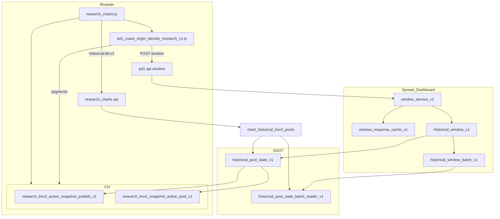

# MC-POOL-P1 — Full Pool Architecture and Performance Audit (READ-ONLY)

**Endstatus:** `MC_POOL_P1_FULL_ARCHITECTURE_AUDIT_COMPLETE`  
**Datum:** 2026-11-26  
**SSOT:** Spread-Clone `spread_recovery_hedge_short_dev` (laufendes `dashboard/`, Live-Dirty-Tree)  
**Baseline:** `stable-mc-baseline-pre-pool-p1` @ `5d15cfaf` (Quellcode-Referenz; Analyse auf **aktuellem Live-Tree**)

**Nicht analysiert als SSOT:** `pools+ob+delta_bot/backtester/short/dashboard/` (Spiegel, kann abweichen).

---

## 0. Executive Summary

Das Research-Dashboard nutzt **mehrere Pool-Pipelines**, die sich gegenseitig ausschließen oder parallel zu anderen Layern laufen:

| Pfad | Primär für | Server-Kern | Client-Kern |
|------|------------|-------------|---------------|
| **A — Exact Origin Density (D2 kanonisch)** | SOLUSDT / Multi-Coin **5m PD1** (u. a.) | `pd1_landscape_viewer_v1` → `historical_pool_state_v1` | `pd1_exact_origin_density_research_v1.js` + TRP `chart.js` (Canvas) |
| **B — Historical LMv2 Zones** | DOGE-Pilot / Static Timeline (wenn Exact Origin **aus**) | `chart_historical_lmv2_pools.py` | `research_charts.js` → DOM-`zone` Overlays |
| **C — Live Micro LLD V2** | Live-Pine-Pools (separat) | `chart_live_micro_lld_v2.py` | `research_charts.js` |
| **D — PD1 Viewer (standalone)** | `/live-charts/viewer` POC | gleiche Window-Builder wie A | `viewer/replay.js` |

Für **MC-POOL-P2 (SOLUSDT 5m, Pools an)** ist Pfad **A** maßgeblich, sofern „Exact Origin Density“ aktiv ist (Default-Konfiguration Research; mutual exclusion mit Historical LMv2 in JS).

**PYTHONPATH (Produktion):** Spread-Root → Spread-`dashboard/` → `pools+ob+delta_bot` → `backtester/short`.  
`app.py` **re-insertet** `dashboard/` explizit vor `pd1_landscape_viewer_v1`, damit der Spiegel `pool_pattern` nicht PD1 shadowed.

**Live-Feature-Flags (systemd, Beispiel):** `HISTORICAL_LMV2_BATCH_READER=1`, `PHASE5S_COMPACT_BATCH_LOADER=1`, `RESEARCH_PANE_GZIP_ENABLED=1`, `PD1_WINDOW_RESPONSE_CACHE` default an.

---

## 1. Kanonische Architektur und Call-Chains

### 1.1 Routing (produktiv)

```
Browser /live-charts/research
  └─ research_charts.js (Host, Pane-Pool, REST)
       ├─ [Exact Origin ON] PD1ExactOriginResearch (pd1_exact_origin_density_research_v1.js)
       │     POST /live-charts/viewer/api/window  (response_mode: exact_origin_v1)
       │     GET  /live-charts/viewer/api/capabilities
       ├─ [Historical LMv2 ON, Exact Origin OFF] POST /api/research/historical-lld-v2-pools
       │     (+ static-timeline / decision-snapshot Varianten)
       ├─ [Live Micro LLD] POST /api/research/live-micro-lld-v2
       └─ TRP iframe pane.html → chart.js (Overlays, Canvas, layoutOverlays)

app.py
  ├─ research_charts.api.build_router  (bounds, candles, historical APIs)
  └─ pd1_landscape_viewer_v1.api.build_router
        POST /live-charts/viewer/api/window → window_service_v1.get_landscape_window_response
```

### 1.2 SSOT — ACTIVE Membership und Snapshot-Catalog

**Modul:** `research_charts/historical_pool_state_v1.py`

| Funktion | Rolle |
|----------|--------|
| `get_published_decision_closes` | Veröffentlichte Decision-Closes (CH via `PublishedActiveReader`) |
| `load_historical_pool_state_at_close` | **Kern:** Publication-Zeile + `research_lmv2_snapshot_active_pool_v1` Catalog + optional Remaining |
| `build_active_episode_records` | Episode-Walk über Closes → Zonen (Historical LMv2 API) |
| `load_window_pool_state` | Fenster-Aggregation für Chart-Adapter |

**ClickHouse (vorberechnete Pools):** u. a.

- `research_lmv2_active_snapshot_publish_v1`
- `research_lmv2_snapshot_active_pool_v1`
- `research_lmv2_active_snapshot_meta_v1` / `member_v1` (Importer-Pipeline)

**Remaining / Traversal:** nicht als fertige Landscape in CH; Laufzeit über `load_historical_remaining` (Adapter, immutable snapshot hashes in `historical_pool_state_v1`).

### 1.3 Kanonische D2 Density (Exact Origin)

**Builder:** `pd1_landscape_viewer_v1/historical_window_v1.py::build_landscape_window`

- `response_mode: exact_origin_v1` → `density_only=True` (keine Candles, keine `clusters_by_dc` in vollem Modus).
- Membership pro Decision-Close: `_load_members` → `load_historical_pool_state_at_close(..., include_remaining=False)`.
- Lifetimes: `_build_lifetimes` auf 5m-Grid (Warmup `WARMUP_HOURS` vor sichtbarem Fenster).
- Optional: `prefill_member_cache_phase5s` (`historical_window_batch_v1.py`) wenn `HISTORICAL_LMV2_BATCH_READER=1`.

**Service-Schicht:** `window_service_v1.get_landscape_window_response`

→ LRU-Cache + Inflight-Dedup (`window_response_cache_v1.py`).

### 1.4 Historical Pool State Batch Reader

**Modul:** `historical_pool_state_batch_reader_v1.py`

- Gate: `historical_lmv2_batch_reader_enabled()` ← Env `HISTORICAL_LMV2_BATCH_READER`
- Compact: `PHASE5S_COMPACT_BATCH_LOADER` → SQL-Variante `compact` vs `legacy`
- Nutzung:
  - PD1 Window: Prefill `member_cache` vor `_build_lifetimes`
  - `chart_historical_lmv2_pools` / static timeline: `build_episode_walk_batch_cache` + `episode_batch` in `build_active_episode_records`
- Cross-window reuse (MC4R): `phase5s_member_prefill_reuse_v1.py` (importiert aus `historical_window_batch_v1.py`; **Live-Untracked**, aber produktiv importiert).

### 1.5 Importpfad-Verifikation (CONFIRMED)

- Laufender Prozess-CWD: `.../spread_recovery_hedge_short_dev/dashboard`.
- `from research_charts.historical_pool_state_v1` in PD1-Modulen resolves zu **Spread-`dashboard/research_charts/`**, nicht Pools-Spiegel, solange `app.py`-Reinsert aktiv bleibt.

---

## 2. Pool-Berechnung und Wiederverwendung

### 2.1 Was liegt in ClickHouse vs. was wird neu berechnet?

| Daten | In CH vorberechnet? | Zur Laufzeit |
|-------|---------------------|--------------|
| ACTIVE Snapshot Publish + Catalog pro `decision_close` | **JA** | Lesen + Kausalitätsprüfung |
| Remaining-Segmente | Teilweise / über Adapter | **JA** — `load_historical_remaining` |
| D2 Density-Lifetimes (Exact Origin) | **NEIN** als fertiges JSON | **JA** — Grid + Membership-Walk |
| Episode-Zonen (Historical LMv2) | **NEIN** | **JA** — `build_active_episode_records` |

### 2.2 Nachgewiesene Redundanzen

| ID | Befund | Klassifikation | Codepfad / Beleg |
|----|--------|----------------|------------------|
| R1 | Pro **neuem** `decision_close` ohne Batch: 1× Publication + 1× Catalog-Query | **CONFIRMED** | `build_active_episode_records` else-Zweig: `_load_publication_line` + `_load_catalog` pro Close (`historical_pool_state_v1.py` ~852–856) |
| R2 | Exact-Origin-Window: `_load_members` ruft pro Cache-Miss volles `load_historical_pool_state_at_close` (Pub+Catalog) auf | **CONFIRMED** | `historical_window_v1.py` `_load_members` ~311–324 |
| R3 | Batch-Prefill reduziert R2 auf gebündelte CH-Reads | **CONFIRMED** (Optimierung vorhanden) | `historical_window_batch_v1.prefill_member_cache_phase5s` + Env |
| R4 | `load_historical_pool_state_at_close` mit `include_remaining=True` (Historical LMv2 **Remaining**) ist schwerer als Active-only | **CONFIRMED** | `chart_historical_lmv2_pools.py` ~183–197 |
| R5 | Published-Closes-Liste pro `(pipeline_line_id, cfg_hash)` nur process-lokal gecacht | **CONFIRMED** | `_PUBLISHED_CLOSES_CACHE` in `get_published_decision_closes` |
| R6 | Pro Window-Request: `member_cache` dict nur **Request-lebenslang**, nicht cross-request | **CONFIRMED** | `build_landscape_window` ~546 |
| R7 | Identischer Window-Request: Server LRU + Inflight | **CONFIRMED** | `window_service_v1` ~207–287, `window_response_cache_v1` |
| R8 | Browser: `fetchWindow` dedup via `inflight` Map gleicher URL-Key | **CONFIRMED** | `pd1_exact_origin_density_research_v1.js` ~1264–1265 |
| R9 | Episode-Walk **ohne** Batch bei N Closes ≈ 2N CH-Queries (Pub+Catalog) | **CONFIRMED** | Schleife in `build_active_episode_records` |
| R10 | Clusters `clusters_by_dc` nur im **Full** compute mode; Exact Origin überspringt | **CONFIRMED** | `build_landscape_window` `density_only` ~538–607 |

### 2.3 Batch Reader konsequent?

| Kontext | Batch aktiv wenn Env=1? | Klassifikation |
|---------|-------------------------|----------------|
| PD1 `build_landscape_window` | Prefill-Phase | **CONFIRMED** |
| `chart_historical_lmv2_pools` (static) | `episode_batch` | **CONFIRMED** |
| `chart_historical_lmv2_pools` (viewport chunks) | analog in Episode-Pfad | **CONFIRMED** (siehe ~331–344) |
| Einzelnes `load_historical_pool_state_at_close` ohne Prefill | **NEIN** | **CONFIRMED** |

### 2.4 Parallele identische Requests

- **Server:** `begin_inflight` / `wait_inflight` — Follower wartet auf Leader (**CONFIRMED**).
- **Client:** `inflight` Map + `exactOriginLoadSerial` / `historicalLmv2RefreshToken` Abbruch (**CONFIRMED**).

---

## 3. ClickHouse-Performance

| Aspekt | Status | Anmerkung |
|--------|--------|-----------|
| Query-Anzahl pro Window | **NOT MEASURED** (Prod) | Struktur: Prefill-`stats.clickhouse_query_count` in `provenance.phase5s_batch_stats` möglich |
| Gelesene Zeilen/Bytes | **NOT MEASURED** | Batch-Modul `_query_stats` existiert (`historical_pool_state_batch_reader_v1.py` ~171) |
| CH Query-Logs | **SUSPECTED** nutzbar | `window_request_trace_v1`, `DogeExactOriginTrace` (Client), Server `log_window_build_complete` |
| Produktions-Lasttests | **NOT DONE** | READ-ONLY-Auftrag |

**CONFIRMED (design-level):** Catalog-Query filtert `snapshot_id`; Publication über `PublishedActiveReader`; Compact-Batch versucht Range-`IN`-Queries statt N Einzelqueries.

---

## 4. Datenübertragung

### 4.1 Exact Origin (`/live-charts/viewer/api/window`)

- Payload enthält: `pools[]` (Segmente), `meta`, `provenance`, `window`, optional `timing_ms`.
- `exact_origin_v1`: **keine** `prices[]` → kleiner als Full-Mode (**CONFIRMED**).
- Limits: `MAX_5M_BARS=864` Server; Client `MAX_API_VISIBLE_MS` / Tile-Planner (**CONFIRMED** in `pd1_exact_origin_density_research_v1.js`).

### 4.2 Historical LMv2 (`/api/research/historical-lld-v2-pools`)

- Liefert `zones[]` (Domain-Segmente), ggf. Remaining — `remaining_limit` default 6500 (**CONFIRMED** `chart_historical_lmv2_pools.py`).
- Chunked loads in JS (`planHistoricalLmv2Chunks`).

### 4.3 Verdächtige Übertragung

| Befund | Klassifikation |
|--------|----------------|
| Pan außerhalb gecachter Tiles → neue Window-POSTs | **CONFIRMED** (Planner + `fetchPlannedWindows`) |
| Pan innerhalb Cache → kein HTTP wenn `fullyCached` | **CONFIRMED** (`refreshPaneImpl` ~1578–1589) |
| Gzip Pane-Payloads (MC-LOAD/MC4O) | **CONFIRMED** (Middleware; separat von Pool-Window JSON) |

**NOT MEASURED:** Mittlere Response-Bytes SOLUSDT 5m in Produktion.

---

## 5. Cache-Inventar

### 5.1 Server

| Cache | Key | TTL | Limit | Invalidierung |
|-------|-----|-----|-------|---------------|
| PD1 Window Response | SHA256 über symbol, from/to, tf, pd, pipeline_line_id, config_hash, compute_mode, builder_version | **Keine TTL** | LRU 32 (`PD1_WINDOW_RESPONSE_CACHE_MAX` max 64) | LRU-Eviction; Env `PD1_WINDOW_RESPONSE_CACHE=0` |
| Published decision closes | `(pipeline_line_id, cfg_hash)` | Prozess-lifetime | unbounded dict | `clear_published_closes_cache()` (Tests) |
| Member cache (window build) | decision_close ISO | Request-scope | — | — |
| Episode walk batch | In-memory object per request | Request-scope | — | — |
| Phase5S prefill reuse store | Env-gesteuert | **SUSPECTED** bounded LRU in `phase5s_member_prefill_reuse_v1` | MC4R-C2 default 4096 | Code im Live-Untracked-File |

### 5.2 Browser

| Cache | Ort | Key / Struktur | Invalidierung |
|-------|-----|----------------|---------------|
| Exact Origin window chunks | `pane.exactOriginWindowStores[scopeKey].chunks` | Adapter `exactOriginCacheKeyForWindow` | PD switch serial, replayGen, scope change |
| Exact Origin segment render | `pane.exactOriginSegmentCache` | `viewportRenderKey + scope` | Viewport/scope change |
| Historical LMv2 | `state.historicalLmv2Cache`, `historicalLmv2ChunkStore`, static/preload blobs | Chunk close ranges | `historicalLmv2RefreshToken`, PD switch clears |
| Overlay sync | `pane.overlayPayloads` | overlay `id` + fingerprint | `syncOverlays` diff |

**CONFIRMED:** Pan/Zoom innerhalb geladenen Exact-Origin-Tiles soll **keine** neuen Window-Fetches auslösen, wenn `fullyCached` und `renderKey` stabil.

**SUSPECTED:** Kleine Viewport-Jitter kann `renderKey` / geplante Tiles ändern → Fetch (P2 messen).

---

## 6. Pan und Zoom — Call-Chain

### 6.1 Event-Quelle (TRP)

`chart.js`:

- `timeScale().subscribeVisibleLogicalRangeChange` / Range-Handler → `layoutOverlays()` (coalesced).
- Overlay range debounce ~ bei sichtbarer Registry (`overlayRangeTimer`, ~972+).
- **CONFIRMED:** `layoutOverlaysNow` culled off-screen DOM zones; `drawEodDensity()` für Canvas-Pools.

Host `research_charts.js`:

- Viewport-Callbacks → `scheduleHistoricalLmv2ViewportLoad` (400 ms `VP_DEBOUNCE_MS`) **nur wenn** Historical LMv2 an und Exact Origin aus.
- Exact Origin: `PD1ExactOriginResearch.scheduleViewport` → `refreshPane({ viewport: true })`.

### 6.2 Matrix Pan/Zoom vs. Arbeit

| Aktion | Exact Origin (A) | Historical LMv2 (B) |
|--------|------------------|---------------------|
| Pan in geladener Historie | Cache hit → Canvas repaint (**CONFIRMED**) | Preload READY → `renderHistoricalLmv2Preloaded` ohne API (**CONFIRMED**); sonst chunk fetch (**CONFIRMED**) |
| Schneller Pan | Debounce 400 ms (**CONFIRMED**) | Gleich |
| Zoom horizontal/vertikal | Neues `renderKey` / Tiles → ggf. Fetch (**SUSPECTED→CONFIRMED** wenn außerhalb Tiles) | Viewport resolver → neue Chunks |
| Preisachse | `drawEodDensity` + DOM layout (**CONFIRMED**) | Overlay reposition |
| Chart Reset | MC-LOAD `resetView` / toolbar — Pool-Pfad über Pane refresh hooks | **SUSPECTED** Full refresh |
| Alte Requests | `exactOriginLoadSerial`, `replayGen`, `historicalLmv2ShouldAbort` | **CONFIRMED** |

---

## 7. Rendering-Performance

| Technik | Pool-Darstellung | Befund |
|---------|------------------|--------|
| Exact Origin + Canvas flag | `eod-density-overlay` Canvas, segment draw mit Viewport-Cull | **CONFIRMED** `chart.js` `drawEodDensity` |
| Exact Origin DOM (legacy) | `zone` overlays via `mergeOverlays` | **CONFIRMED** wenn Canvas aus |
| Historical LMv2 | DOM `.ov-zone` in `overlayRegistry` | **CONFIRMED**; Cull >120 overlays forces `layoutOverlays` |
| Incremental | `syncOverlays` add/update/remove by id+fingerprint | **CONFIRMED** |
| Stable IDs | `pool_id` / zone ids aus Server | **CONFIRMED** |
| Main-thread | Coalesced layout; tooltip einmalig pro Zone | **CONFIRMED** Kommentar ~3131 `chart.js` |

**CONFIRMED:** Mathematische Pool-Konstruktion (Server) ist getrennt von grafischer Positionierung (`yOf`, `layoutOverlays`, Canvas clip).

**NOT MEASURED:** FPS / Long Tasks in Browser.

---

## 8. Live-Pool-Updates

| Pfad | Verhalten | Klassifikation |
|------|-----------|----------------|
| Exact Origin + Live | `historyBlocksLive`, Replay `as_of` — kein Future-Pool | **CONFIRMED** in viewport resolver |
| Live Micro LLD V2 | Eigener Poll/Refresh, nicht PD1 SSOT | **CONFIRMED** |
| Historical LMv2 Live restore | `historical-lmv2 live restore` Pfad in `research_charts.js` | **CONFIRMED** |
| ACTIVE vs Remaining | Separate Checkboxen; Remaining teurer | **CONFIRMED** |

**SUSPECTED:** Ob Live-Tick alle historischen Tiles invalidiert — P2 mit Trace.

---

## 9. Single- und Multi-Chart

- Panes isoliert: `pane.exactOriginWindowStores`, `pane.historicalLmv2LoadSerial`, `exactOriginEnabledForPane` (**CONFIRMED**).
- Multi-Chart: unterschiedliche Symbole → eigene capability bounds / scope keys (**CONFIRMED** `MC4_5M_PD1_SYMBOLS` includes SOLUSDT).
- Cache-Sharing: **nur** bei identischem Scope+Window-Key; nicht global cross-pane (**CONFIRMED**).
- Global refresh: `repaintExactOriginDensityAllVisiblePanes`, `state.historicalLmv2RefreshToken` (**CONFIRMED**).

**SUSPECTED:** 2×2 gleiches Symbol/TF könnte theoretisch identische Window-Keys teilen — Server inflight hilft; Browser `inflight` ist pro Tab-JS, nicht cross-pane (**NOT MEASURED**).

---

## 10. Bereits vorhandene Optimierungen (CONFIRMED)

1. `HISTORICAL_LMV2_BATCH_READER` + Compact Batch Loader  
2. PD1 Window Response LRU + Inflight dedup  
3. Phase5S member prefill + reuse (Env + untracked module)  
4. Browser chunk planner + concurrent fetch limit (2, 1h: 3)  
5. `fullyCached` short-circuit ohne HTTP  
6. DOM overlay culling + layout coalescing  
7. EOD Canvas strict viewport cull  
8. `syncOverlays` incremental diff  
9. Gzip pane middleware (Bandbreite Pane-HTML/JSON, nicht Window)

---

## 11. Priorisierte Engpässe (für MC-POOL-P2+)

| Prio | Engpass | Klassifikation | Hypothese |
|------|---------|----------------|-----------|
| P0 | Window-Build CPU + CH bei großen sichtbaren Spannen (trotz Batch) | **SUSPECTED** | Viele unique decision closes im Warmup-Grid |
| P0 | Exact Origin Tile-Miss bei Pan → POST-Sturm | **SUSPECTED** | Planner-Tilegrenzen vs. schneller Pan |
| P1 | Historical LMv2 Remaining am `as_of` | **CONFIRMED** teuer wenn aktiv | Ein Full-State pro Request |
| P1 | DOM-Historical-Zones > ~120 Overlays | **CONFIRMED** Pfad | layout thrash |
| P2 | Kein TTL auf Server Window Cache | **CONFIRMED** | Stale bei Publish-Refresh bis Eviction |
| P2 | `_PUBLISHED_CLOSES_CACHE` ohne Invalidierung bei neuem Publish | **SUSPECTED** | Prozess-langlebig |
| P3 | Doppelte Pipeline (Exact Origin vs LMv2) — Nutzerfehler wenn beide an | **CONFIRMED** exclusion in `scheduleHistoricalLmv2ViewportLoad` |

---

## 12. MC-POOL-P2 — Testmatrix und Messplan

### 12.1 Voraussetzungen

- Symbol **SOLUSDT**, Chart **5m**, Pool-TF **5m**, **PD1** checked (Exact Origin).
- Browser: `DogeExactOriginTrace` / `window.DogeExactOriginTrace.enabled()` falls verfügbar.
- Optional: `?historical_lmv2_debug=1` nur wenn Test B mit Historical LMv2.
- MC-LOAD Diag: `__MC_LOAD_DIAG__` / `mc_load_diag_v1.js` — **nicht** Pool-spezifisch, aber Viewport-Events nutzbar.

### 12.2 Testfälle

| ID | Szenario | Primäre Events / Metriken |
|----|----------|---------------------------|
| A | Pools einschalten | `window_http_request` count, `timing_ms.total` in Response, TTF erste Segmente, `exactOriginLoadSerial` |
| B | Aus → wieder an | Cache clears (`bumpExactOriginLoadSerial`), erneute POST-Anzahl |
| C | Pan innerhalb geladener Historie | **0 neue** `window_http_request` (Trace), `fullyCached` / hint „cache“, Canvas `eodDensityLastDraw` |
| D | Schneller Pan | Debounce ~400 ms aggregated requests, `scheduleSupersededDensityRefresh` |
| E | H+V Zoom | `renderKey` change, neue Tiles, segment count, layout time |
| F | Pan außerhalb geladenen Bereichs | `fetchPlannedWindows.fetched` > 0, `response_cache.hit` false |
| G | Symbolwechsel | scope key / caps reload, store isolation per pane |
| H | Timeframe-Wechsel | planner mode/tile change, invalidation |
| I | Live-Pool-Update / neuer Close | **NOT MEASURED** — Poll-Pfade identifizieren (Live Micro vs Replay) |
| J | 2×2 Multi, verschiedene Symbole | parallele inflight max 2, pro-pane serial |

### 12.3 Server-Metriken (ohne neue Prod-Queries)

- Response-Feld: `provenance.phase5s_batch_stats`, `response_cache.hit`, `timing_ms` in Window JSON.
- Logs: `dashboard-user` journal — `log_window_build_complete` Zeilen.

### 12.4 Pass/Fail-Kriterien (Vorschlag P2)

- **C/D:** Median 0 HTTP Window-Requests pro 5 s Pan innerhalb Cache.  
- **A:** dokumentierte Baseline `wall_ms` + Segmentzahl.  
- Keine Regression MC-LOAD viewport reset (separates Diag).

---

## 13. Architekturdiagramm (Vereinfacht)



---

## 14. Bezug Recovery

- Analysebasis: Live-Tree + dokumentierter Checkpoint `5d15cfaf` (identische 20 Produktivdateien für Pool/PD1-Kern).
- **Keine** Code-, DB-, Deploy- oder Git-Änderungen in MC-POOL-P1.

---

## 15. Dateireferenzen (Spread SSOT)

| Datei | Rolle |
|-------|--------|
| `dashboard/research_charts/historical_pool_state_v1.py` | SSOT ACTIVE + Remaining |
| `dashboard/research_charts/historical_pool_state_batch_reader_v1.py` | CH Batch |
| `dashboard/pd1_landscape_viewer_v1/historical_window_v1.py` | D2 Landscape Builder |
| `dashboard/pd1_landscape_viewer_v1/window_service_v1.py` | API Service + Cache |
| `dashboard/pd1_landscape_viewer_v1/window_response_cache_v1.py` | Server LRU |
| `dashboard/pd1_landscape_viewer_v1/historical_window_batch_v1.py` | Prefill |
| `dashboard/research_charts/chart_historical_lmv2_pools.py` | Research LMv2 API adapter |
| `dashboard/research_charts/api.py` | HTTP Routes |
| `dashboard/static/js/research/pd1_exact_origin_density_research_v1.js` | Client D2 |
| `dashboard/static/js/research/research_charts.js` | Host + LMv2 |
| `dashboard/static/research_trp/chart.js` | Rendering |

---

**Endstatus:** `MC_POOL_P1_FULL_ARCHITECTURE_AUDIT_COMPLETE`